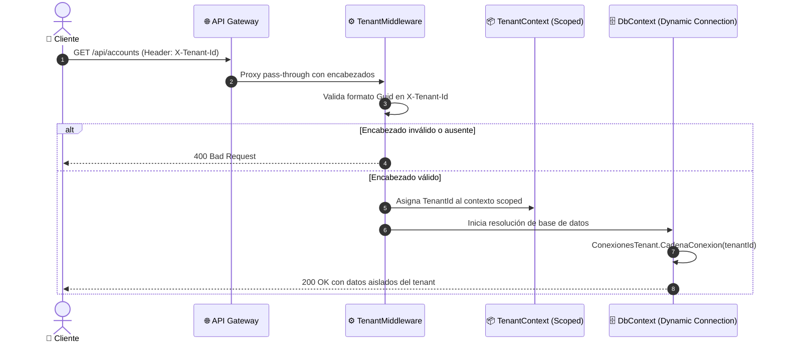

# Tuki

<div align="center">


### Plataforma de Registro Contable Personal Multitenant

[](#10-licencia-y-propiedad)
[](https://dotnet.microsoft.com/)
[](https://learn.microsoft.com/dotnet/csharp/)
[](https://www.postgresql.org/)
[](https://microsoft.github.io/reverse-proxy/)
[](https://scalar.com/)
[](https://learn.microsoft.com/ef/core/)

**Tuki** es un ecosistema moderno para la gestión y registro contable personal, diseñado con arquitectura orientada a microservicios en **.NET 10**, aislamiento de datos estricto por cliente (**database-per-tenant** en **PostgreSQL**), enrutamiento centralizado mediante **YARP** y documentación interactiva unificada con **Scalar**.

</div>

---

## Tabla de contenidos

1. [Descripción del proyecto](#1-descripción-del-proyecto)
2. [Arquitectura del sistema](#2-arquitectura-del-sistema)
3. [Tecnologías y herramientas](#3-tecnologías-y-herramientas)
4. [Estructura de microservicios y puertos](#4-estructura-de-microservicios-y-puertos)
5. [Multitenencia y aislamiento de datos](#5-multitenencia-y-aislamiento-de-datos)
6. [API Gateway y enrutamiento (YARP)](#6-api-gateway-y-enrutamiento-yarp)
7. [Documentación interactiva de APIs (Scalar)](#7-documentación-interactiva-de-apis-scalar)
8. [Certificado HTTPS de desarrollo](#8-certificado-https-de-desarrollo)
9. [Puesta en marcha y ejecución](#9-puesta-en-marcha-y-ejecución)
10. [Licencia y propiedad](#10-licencia-y-propiedad)

---

## 1. Descripción del proyecto

Tuki permite a los usuarios llevar el control total de sus finanzas personales: administración de cuentas financieras, registro de transacciones e ingresos/gastos clasificados por categorías y marcadores, planificación presupuestaria con topes mensuales, y gestión de planes de suscripción para usuarios.

### Principales capacidades

- **Microservicios desacoplados:** Cada dominio de negocio vive en un servicio autónomo con su propio contexto y ciclo de vida.
- **Multitenencia física (Database-per-Tenant):** Cada usuario/organización dispone de sus propias bases de datos aisladas en PostgreSQL para garantizar privacidad y seguridad total.
- **Aprovisionamiento automático:** Al registrarse un usuario, el sistema aprovisiona de forma reactiva las bases de datos de todos los microservicios de negocio aplicando migraciones automáticas.
- **Gateway centralizado:** Un único punto de entrada expone la API pública, distribuye tráfico con proxy inverso y centraliza la documentación Swagger/OpenAPI.
- **Planes y suscripciones SaaS:** Control de acceso basado en vigencia de suscripciones evaluado dinámicamente en tiempo de ejecución.

---

## 2. Arquitectura del sistema

El sistema sigue una arquitectura de microservicios donde las aplicaciones cliente (app móvil React Native y clientes web) se comunican exclusivamente a través del **API Gateway** (puerto `5000`). El Gateway resuelve las peticiones hacia el servicio correspondiente y unifica la documentación OpenAPI de todo el ecosistema.

```mermaid
flowchart TD
    Client["📱 App Móvil / Cliente Web"] -->|HTTPS / JWT| GW["🌐 API Gateway (YARP)<br/>Puerto 5000 /scalar"]

    subgraph Backend [Backend Microservicios .NET 10]
        GW -->|/api/auth, /api/users<br/>(login y registro)| Auth["🔑 Tuki.Autenticacion<br/>Puerto 5105"]
        GW -->|/api/plans,<br/>/api/subscriptions, /api/tenants| Admin["🛡️ Tuki.Administrador<br/>Puerto 5101"]
        GW -->|/api/accounts, /api/account-types,<br/>/api/categories<br/>+ X-Tenant-Id| Cuentas["💳 Tuki.Cuentas<br/>Puerto 5102"]
        GW -->|/api/tags, /api/shortcuts,<br/>/api/transactions + X-Tenant-Id| Mov["📊 Tuki.Movimientos<br/>Puerto 5103"]
        GW -->|/api/budgets<br/>+ X-Tenant-Id| Pres["🎯 Tuki.Presupuestos<br/>Puerto 5104"]

        Auth -.->|POST /internal/tenants<br/>GET .../status| Admin
        Admin -.->|POST /internal/tenants/{id}/database| Cuentas
        Admin -.->|POST /internal/tenants/{id}/database| Mov
        Admin -.->|POST /internal/tenants/{id}/database| Pres
    end

    subgraph PostgreSQL [Servidor PostgreSQL :5432]
        Auth --> DBAuth[("🗄️ tuki_autenticacion<br/>(Global)")]
        Admin --> DBAdmin[("🗄️ tuki_admin<br/>(Global)")]
        Cuentas --> DBCuentas[("🗄️ tuki_cuentas_{tenantId}")]
        Mov --> DBMov[("🗄️ tuki_movimientos_{tenantId}")]
        Pres --> DBPres[("🗄️ tuki_presupuestos_{tenantId}")]
    end
```

---

## 3. Tecnologías y herramientas

### Backend

- **Plataforma:** [.NET 10](https://dotnet.microsoft.com/) (C# 13) con ASP.NET Core Web APIs.
- **Acceso a datos:** [Entity Framework Core 10](https://learn.microsoft.com/ef/core/) con proveedor [Npgsql](https://www.npgsql.org/) y convención de nombres `snake_case`.
- **Motor de base de datos:** [PostgreSQL 16+](https://www.postgresql.org/).
- **Reverse Proxy & Gateway:** [YARP 2.3](https://microsoft.github.io/reverse-proxy/) (Yet Another Reverse Proxy).
- **Documentación de APIs:** [Scalar.AspNetCore](https://scalar.com/) y soporte OpenAPI nativo de .NET.
- **Herramientas de desarrollo:** Node.js (`concurrently`) para ejecución coordinada de servicios y `csharpier` para formateo de código.

### Clientes (Diseño)

- **App Móvil:** React Native (Expo) enfocado en dispositivos Android/iOS con sincronización sin conexión.

---

## 4. Estructura de microservicios y puertos

Todos los servicios del backend escuchan exclusivamente a través de **HTTPS** en el entorno local:

| Servicio | Puerto | Responsabilidad de dominio | Base de datos | Prefijo de API |
| :--- | :---: | :--- | :--- | :--- |
| **Tuki.Gateway** | `5000` | Punto de entrada unificado, enrutamiento inverso y catálogo OpenAPI con Scalar | — | `/`, `/scalar`, `/openapi/*` |
| **Tuki.Administrador** | `5101` | Tenants, aprovisionamiento de bases, planes SaaS y suscripciones | `tuki_admin` *(Global)* | `/api/plans`, `/api/subscriptions`, `/api/tenants` |
| **Tuki.Autenticacion** | `5105` | Login y registro de usuarios (credenciales y tokens JWT) | `tuki_autenticacion` *(Global)* | `/api/auth`, `/api/users` |
| **Tuki.Cuentas** | `5102` | Cuentas monetarias, tipos de cuenta y categorías de clasificación | `tuki_cuentas_{tenantId}` | `/api/accounts`, `/api/account-types`, `/api/categories` |
| **Tuki.Movimientos** | `5103` | Transacciones financieras, líneas de asiento, marcadores y atajos | `tuki_movimientos_{tenantId}` | `/api/tags`, `/api/shortcuts`, `/api/transactions` |
| **Tuki.Presupuestos** | `5104` | Metas de gasto y límites presupuestarios mensuales por categoría | `tuki_presupuestos_{tenantId}` | `/api/budgets` |

---

## 5. Multitenencia y aislamiento de datos

El sistema implementa el patrón **Database-per-Tenant** para máxima seguridad y aislamiento entre usuarios.

### 5.1 Nomenclatura dinámica de bases de datos

Las bases de datos se generan dinámicamente mediante la fórmula:

```
tuki_{nombre_servicio}_{tenantId}
```

Donde `{tenantId}` es un `Guid` formateado en representación compacta sin guiones (`N`), por ejemplo: `tuki_cuentas_3fa85f6457174562b3fc2c963f66afa6`.

### 5.2 Resolución del Tenant por petición

Cada solicitud dirigida a los servicios de negocio debe incluir el identificador del tenant en el encabezado `X-Tenant-Id`.



### 5.3 Flujo de aprovisionamiento reactivo al registrar usuario

```mermaid
sequenceDiagram
    autonumber
    actor U as 👤 Nuevo Usuario
    participant GW as 🌐 API Gateway
    participant Auth as 🔑 Tuki.Autenticacion
    participant Admin as 🛡️ Tuki.Administrador
    participant PS as ⚙️ ProvisioningService
    participant C as 💳 Cuentas
    participant M as 📊 Movimientos
    participant P as 🎯 Presupuestos

    U->>GW: POST /api/users/register
    GW->>Auth: /api/autenticacion/users/register
    Auth->>Auth: Normaliza el correo; 409 si ya existe
    Auth->>Admin: POST /internal/tenants
    Admin->>Admin: Crea el Tenant (Estado: Provisioning)
    Admin->>PS: Inicia aprovisionamiento de bases
    par Aprovisionamiento paralelo/secuencial
        PS->>C: POST /internal/tenants/{id}/database
        C->>C: EF Core MigrateAsync()
        C-->>PS: 201 Created / 200 AlreadyExisted
    and
        PS->>M: POST /internal/tenants/{id}/database
        M->>M: EF Core MigrateAsync()
        M-->>PS: 201 Created / 200 AlreadyExisted
    and
        PS->>P: POST /internal/tenants/{id}/database
        P->>P: EF Core MigrateAsync()
        P-->>PS: 201 Created / 200 AlreadyExisted
    end
    PS->>Admin: Registra eventos en provisioning_events
    Admin->>Admin: Actualiza estado del Tenant a 'Active' o 'Failed'
    Admin-->>Auth: 200 { tenantId, status, services }
    Auth->>Auth: Guarda el usuario con ese tenantId (incluso si status es Failed)
    Auth-->>U: 201 Created (Active) / 502 (si no está Active)
```

---

## 6. API Gateway y enrutamiento (YARP)

El microservicio **Tuki.Gateway** actúa como fachada única hacia el exterior implementando **YARP (Yet Another Reverse Proxy)**.

### Mapeo de rutas

Cada recurso se publica sin el nombre del servicio y el Gateway lo reenvía a la ruta interna con prefijo:

- `/api/auth/**`, `/api/users/**` ➔ `https://localhost:5105/api/autenticacion/<recurso>/**`
- `/api/plans/**`, `/api/subscriptions/**`, `/api/tenants/**` ➔ `https://localhost:5101/api/admin/<recurso>/**`
- `/api/accounts/**`, `/api/account-types/**`, `/api/categories/**` ➔ `https://localhost:5102/api/cuentas/<recurso>/**`
- `/api/tags/**`, `/api/shortcuts/**`, `/api/transactions/**` ➔ `https://localhost:5103/api/movimientos/<recurso>/**`
- `/api/budgets/**` ➔ `https://localhost:5104/api/presupuestos/budgets/**`

Adicionalmente, el Gateway expone rutas transformadas para obtener las especificaciones OpenAPI de cada microservicio. Apuntan al documento público (`publico`), que muestra las rutas ya sin el segmento del servicio:

- `/openapi/autenticacion.json` ➔ `https://localhost:5105/openapi/publico.json`
- `/openapi/administrador.json` ➔ `https://localhost:5101/openapi/publico.json`
- `/openapi/cuentas.json` ➔ `https://localhost:5102/openapi/publico.json`
- `/openapi/movimientos.json` ➔ `https://localhost:5103/openapi/publico.json`
- `/openapi/presupuestos.json` ➔ `https://localhost:5104/openapi/publico.json`

### Recursos públicos por servicio

Las llamadas por el Gateway no revelan el servicio de origen: cada recurso se publica bajo `/api/<recurso>` y el Gateway lo reenvía al servicio interno correspondiente.

| Recurso público     | Servicio        |
| ------------------- | --------------- |
| `/api/auth`         | Autenticación   |
| `/api/users`        | Autenticación   |
| `/api/plans`        | Administrador   |
| `/api/subscriptions`| Administrador   |
| `/api/tenants`      | Administrador   |
| `/api/accounts`     | Cuentas         |
| `/api/account-types`| Cuentas         |
| `/api/categories`   | Cuentas         |
| `/api/tags`         | Movimientos     |
| `/api/shortcuts`    | Movimientos     |
| `/api/transactions` | Movimientos     |
| `/api/budgets`      | Presupuestos    |

**Regla:** cada controlador nuevo exige agregar su recurso a la lista de su servicio en `backend/src/Tuki.Gateway/appsettings.json` y ejecutar `scripts/verificar-rutas.sh` para comprobar que el Gateway lo enruta.

---

## 7. Documentación interactiva de APIs (Scalar)

Toda la documentación y pruebas de los servicios se gestionan con **Scalar**:

- **Documentación unificada en Gateway:** Disponible en entorno de desarrollo en:
  ```
  https://localhost:5000/scalar
  ```
  Permite alternar entre los documentos de los 5 microservicios desde una sola interfaz centralizada.
- **Documentación individual por servicio:**
  - Autenticación: `https://localhost:5105/scalar`
  - Administrador: `https://localhost:5101/scalar`
  - Cuentas: `https://localhost:5102/scalar`
  - Movimientos: `https://localhost:5103/scalar`
  - Presupuestos: `https://localhost:5104/scalar`

> **Nota:** Al probar peticiones a los servicios de Cuentas, Movimientos o Presupuestos, debe incluirse el encabezado `X-Tenant-Id` con un `Guid` de un tenant aprovisionado.

---

## 8. Certificado HTTPS de desarrollo

Todos los servicios del backend escuchan exclusivamente bajo HTTPS en local (`https://localhost:5000` y `5101` a `5105`). Para que los servicios, las herramientas HTTP y el navegador confíen en el certificado de desarrollo, debe instalarse **una vez por equipo**.

### Windows

Abre PowerShell como administrador y ejecuta:

```powershell
dotnet dev-certs https --trust
```

Confirma el diálogo de instalación que muestra el sistema operativo.

### Linux (Ubuntu / Debian)

En distribuciones Linux el certificado debe incorporarse al almacén del sistema operativo:

```bash
dotnet dev-certs https --clean
dotnet dev-certs https --export-path ~/aspnet-dev-localhost.crt --format Pem --no-password
sudo cp ~/aspnet-dev-localhost.crt /usr/local/share/ca-certificates/aspnet-dev-localhost.crt
sudo update-ca-certificates
```

### Comprobación de instalación

Con un servicio en ejecución, verifica que no existan advertencias ni errores SSL:

```bash
curl -I https://localhost:5102
```

---

## 9. Puesta en marcha y ejecución

### Requisitos previos

- SDK de [.NET 10.0](https://dotnet.microsoft.com/download/dotnet/10.0)
- [Node.js](https://nodejs.org/) (versión 18 o superior)
- Servidor [PostgreSQL](https://www.postgresql.org/) con un usuario configurado con privilegios `CREATEDB`

### Pasos de configuración

1. **Clonar el repositorio:**
   ```bash
   git clone <url-del-repositorio>
   cd Tuki
   ```

2. **Configurar variables de entorno:**
   Copia el archivo base y define la contraseña de tu PostgreSQL:
   ```bash
   cp .env.example .env
   # Editar .env con tus credenciales de PostgreSQL
   ```

3. **Instalar dependencias del orquestador local:**
   ```bash
   npm install
   ```

4. **Levantar todo el ecosistema con un único comando:**
   ```bash
   npm run dev
   ```
   Este comando lanza en paralelo con `dotnet watch` los seis servicios: Gateway (`5000`), Administrador (`5101`), Autenticación (`5105`), Cuentas (`5102`), Movimientos (`5103`) y Presupuestos (`5104`).

5. **Compartir el Gateway con los probadores (Microsoft Dev Tunnels):**

   El reenvío está integrado en VS Code, así que no hace falta instalar extensiones ni la CLI. La dirección pública que recibe el probador **siempre termina en HTTPS** (el certificado es de Microsoft); el puerto local solo define el enlace interno entre el agente y esta máquina.

   **Puertos del Gateway:**

   | Puerto | Escucha en | Para qué sirve |
   |---|---|---|
   | `5000` | `localhost` (HTTPS) | Pruebas en local: `https://localhost:5000`, Scalar, curl con `-k` |
   | `5005` | `0.0.0.0` (HTTP) | **Solo** para el túnel; no se expone a internet por sí mismo |

   El `5005` debe quedar en `0.0.0.0` y no en `localhost`: el agente del túnel reenvía hacia la IP local de la máquina (`192.168.x.x`), no hacia `127.0.0.1`. `launchSettings.json` ya lo declara así; si cambias ese archivo, **reinicia la tarea del backend**, porque `launchSettings` solo se lee al arrancar.

   **Procedimiento:**

   1. Encender el backend: **Ctrl+Shift+B** (tarea `tuki: backend`).
   2. Panel inferior → pestaña **Puertos** → **Reenviar puerto** → escribe `5005`.
   3. Si VS Code pide iniciar sesión, usa tu cuenta de GitHub.
   4. Clic derecho sobre la fila → **Visibilidad del puerto → Pública**. Espera a que la columna diga *Pública*.
   5. Copia la dirección, con forma de `https://<id>-5005.brs.devtunnels.ms`.
   6. Verifícala antes de compartirla:

      ```bash
      ./scripts/verificar-tunel.sh https://<id>-5005.brs.devtunnels.ms
      ```

      Debe informar `HTTP 200` en `/api/plans`, además del aislamiento con `X-Tenant-Id` y el preflight CORS.
   7. Comparte la dirección con cada probador **junto con su `tenantId`, siempre por privado**. Nunca se publica en el foro ni en las capturas.

   **Pruebas completas contra el túnel** (mismos scripts que en local):

   ```bash
   GATEWAY=https://<id>-5005.brs.devtunnels.ms ./scripts/verificar-rutas.sh
   GATEWAY=https://<id>-5005.brs.devtunnels.ms ./scripts/pruebas-cuentas.sh
   ```

   Cada probador comprueba su acceso con su cabecera:

   ```bash
   curl -s https://<id>-5005.brs.devtunnels.ms/api/accounts -H "X-Tenant-Id: <tenantId-privado>"
   ```

   **Diagnóstico de errores frecuentes:**

   | Síntoma | Causa | Solución |
   |---|---|---|
   | `502` con el Gateway accesible en local | El Gateway solo escucha en `127.0.0.1` | Asegurar `http://0.0.0.0:5005` en `launchSettings.json` y reiniciar la tarea |
   | Tiempo de espera con `0 bytes` | Se reenvió el `5000` (HTTPS con certificado de desarrollo) y el agente habla HTTP | Reenviar el **`5005`**, no el `5000` |
   | Página de inicio de sesión de Microsoft y "Continuar" girando | El puerto quedó en visión **Privada** | Poner **Visibilidad → Pública** y reabrir la dirección |
   | `404` en el túnel pero `200` en local | El reenvío apunta a un puerto sin servicio | Comprobar que `5005` está reenviado y escuchando |
   | Los servicios no aplican un cambio de código | `dotnet watch` dejó de detectar cambios | Reiniciar la tarea (**Ctrl+C** → **Ctrl+Shift+B**) |

   **Alternativa con la CLI**, que mantiene una URL fija durante el día:

   ```bash
   ./scripts/tunel.sh preparar   # una vez: login, túnel tuki-gateway y puerto 5005
   ./scripts/tunel.sh            # deja el túnel abierto (Ctrl+C lo detiene)
   ```

   > Para usar la CLI hay que instalarla primero y hacer login una vez:
   >
   > ```bash
   > curl -sL https://aka.ms/DevTunnelCliInstall | bash   # el binario queda en ~/bin
   > chmod +x ~/bin/devtunnel                             # el instalador no siempre lo hace
   > export PATH="$HOME/bin:$PATH"                        # para que tunel.sh lo encuentre
   > ~/bin/devtunnel user login -d                        # imprime el código de acceso
   > ```
   >
   > El instalador intenta usar `sudo` para agregar la herramienta al PATH; no hace falta, porque el binario ya queda en el directorio de usuario.

   Desde VS Code también están listas las tareas (**Terminal → Ejecutar tarea…**): `tuki: backend` (Ctrl+Shift+B), `tuki: preparar túnel (una vez)`, `tuki: backend + túnel (CLI)` y `tuki: verificar rutas`.

   **Documentación que ven los probadores:** Scalar se sirve en `https://<id>-5005.brs.devtunnels.ms/scalar/` (sin barra final redirige a esa misma ruta). Los documentos OpenAPI no declaran hosts absolutos y el Gateway usa la URL base dinámica de Scalar, así que las llamadas salen contra la dirección por la que se abrió la página (local o túnel) en lugar de contra `localhost:510x`.

   **Durante la ventana de pruebas deben seguir corriendo dos cosas**: la tarea del backend y el reenvío del puerto `5005`. Si se cierra alguna, la dirección deja de responder.

---

## 10. Licencia y propiedad

Este proyecto y su código fuente son de carácter **privado y confidencial**. Todos los derechos están reservados. Queda prohibida la copia, distribución, modificación o uso comercial no autorizado sin el consentimiento explícito de los autores.
