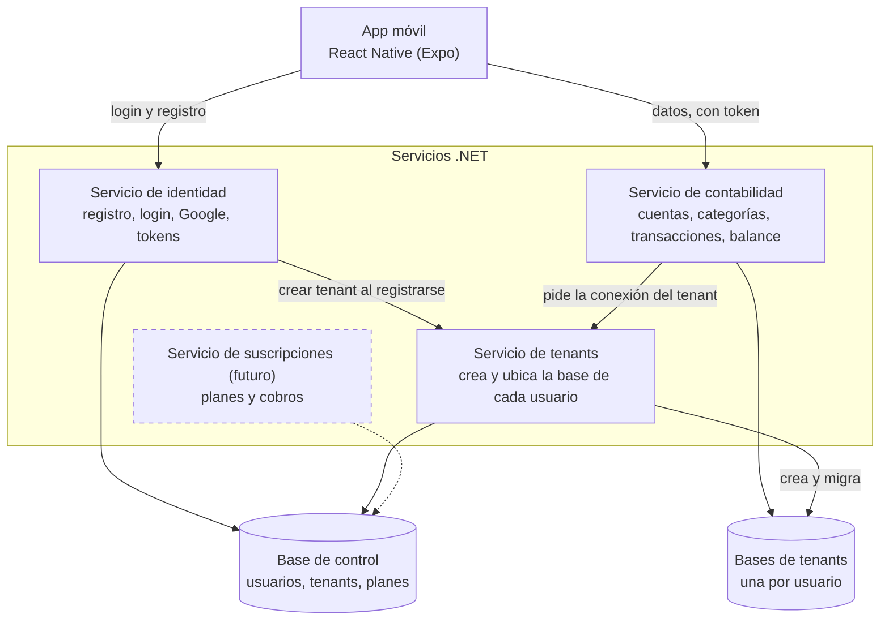

# Tuki: resumen del levantamiento de requerimientos

> Archivo: `docs/00-resumen-levantamiento.md`
> Nombre clave del proyecto: **Tuki** (no es el nombre definitivo).
> Fecha: octubre de 2026. Estado: levantamiento inicial (sesión 1).
> Plazo: el MVP debe estar listo en 2 semanas y se concibe como una **beta para experimentar y aprender**.

Este documento reúne todo lo decidido hasta ahora. Cada decisión viene del cliente (el usuario más interesado en el producto). Lo que aún es propuesta o está abierto se marca así y se resume en la sección 12.

---

## 1. Contexto y objetivo

- Proyecto de una materia cuyo tema central es un **SaaS con multitenencia**.
- Producto: una **app de registro contable personal y personalizable**, pensada primero para móvil.
- Meta de producto: superar a la app "Registro contable" de la Play Store.
- Lo exigido por la materia es el **backend**. Aun así se presentará también el frontend móvil en React Native.
- El plan de suscripciones debe estar **diagramado y contemplado** en el diseño, aunque no se implemente.
- Dinámica de trabajo del levantamiento: Claude como desarrollador que levanta requerimientos y el cliente como usuario más interesado.

## 2. Usuario objetivo y problema

**Usuario objetivo:** personas que quieren llevar su contabilidad personal de forma meticulosa y rápida. No está pensada para negocios, aunque no se descarta que algunos la usen así.

**Problemas de la app competidora**

- Registrar un solo gasto es tedioso.
- No cubre a los deudores (personas que le deben al usuario o a quienes él les debe).
- Las categorías son pobres.

## 3. Propuesta de valor y diferenciadores

- Registro en **1 o 2 clics** mediante atajos de gastos rutinarios (por ejemplo, un licuado de 5 Bs).
- **Personas como cuentas**, con saldos que muestran quién le debe a quién.
- **Personalización total**: categorías, subcategorías y cuentas propias (efectivo, banco, cuentas digitales como Binance).
- Ayuda para quien no sabe administrar sus cuentas desde el primer día.
- Diseño agradable, con animaciones.

## 4. Requerimientos funcionales del MVP

| ID    | Requerimiento                                                                                                                  | Prioridad          |
| ----- | ------------------------------------------------------------------------------------------------------------------------------ | ------------------ |
| RF-01 | Registro e inicio de sesión con correo y contraseña                                                                            | Entra              |
| RF-02 | Inicio de sesión con Google (OAuth)                                                                                            | Depende del tiempo |
| RF-03 | Creación automática del espacio (base de datos) de cada usuario al registrarse                                                 | Entra              |
| RF-04 | Bloqueo local de la app con PIN                                                                                                | Entra              |
| RF-05 | Cuentas: crear y editar; "Efectivo" por defecto; saldo inicial; tipos preestablecidos (tarjeta bancaria, cuenta digital, otro) | Entra              |
| RF-06 | Personas como cuentas, con saldo con signo y pagos parciales mediante traslados                                                | Entra              |
| RF-07 | Categorías y subcategorías (dos niveles) con un conjunto base totalmente editable                                              | Entra              |
| RF-08 | Movimientos de tipo gasto, ingreso y traslado, con transacciones de varias líneas (modelo de datos)                            | Entra              |
| RF-09 | Atajos de gastos rutinarios con registro en 1 clic y aviso para deshacer o editar el monto                                     | Entra              |
| RF-10 | Pantalla principal: saldo total y por cuenta, deudas pendientes y gasto del mes por categoría                                  | Entra              |
| RF-11 | Frases guía en la pantalla de registro (una pregunta corta bajo cada tipo de movimiento)                                       | Entra              |
| RF-12 | Interfaz completa para dividir una transacción en varias líneas o cuentas                                                      | Depende del tiempo |
| RF-13 | Onboarding corto: configurar categorías, atajos y saldos iniciales                                                             | Depende del tiempo |
| RF-14 | Animaciones básicas                                                                                                            | Depende del tiempo |
| RF-15 | Filtros del balance más allá del período                                                                                       | Depende del tiempo |

**Criterio de prioridad:** el backend es la prioridad número 1. El frontend avanza por orden de importancia, y lo que no alcance hasta la fecha de presentación se deja fuera con una justificación escrita.

## 5. Fuera del MVP (ideas para después)

- Frontend web.
- Modo offline y sincronización.
- Varias monedas y tipos de cambio (posiblemente con un servicio externo de cotización).
- Plantillas y personalización avanzada.
- Importación de categorías y cuentas generadas con la IA personal del usuario (archivo `.md` o `.json` a partir de un prompt que entrega la app).
- Lector de recibos (escanear el ticket del súper y extraer los datos del gasto).
- Exportación de datos (aún por definir si entra en alguna versión temprana).
- Notificaciones y widgets con recordatorios según el momento del día (por ejemplo, el desayuno).
- Rachas y otros incentivos para que la gente no abandone la app.
- Premium, anuncios y monetización implementada.
- Cuentas compartidas entre personas.
- Ejemplo guiado en el onboarding y ayuda contextual (tooltips, cuenta de muestra).
- Desbloqueo con huella digital.

## 6. Reglas de negocio

### 6.1 Cuentas y personas

- Cada usuario crea sus cuentas. "Efectivo" existe por defecto y todas tienen saldo inicial.
- Las **personas son cuentas** con saldo con signo:
  - saldo positivo: la persona le debe al usuario;
  - saldo negativo: el usuario le debe a la persona;
  - saldo cero: sin deuda.
- Los pagos parciales son obligatorios y se resuelven con traslados que suman o restan al saldo.

### 6.2 Gasto, ingreso o traslado

Regla para decidir el tipo de movimiento: **¿el usuario consumió algo?**

| Tipo     | Cuándo se usa                                                                     | Ejemplo                                                                 |
| -------- | --------------------------------------------------------------------------------- | ----------------------------------------------------------------------- |
| Gasto    | El usuario consumió algo; sale de la cuenta que lo pagó (propia o de una persona) | Un amigo paga la comida del usuario                                     |
| Ingreso  | Entra dinero nuevo a una cuenta                                                   | Sueldo, venta, regalo                                                   |
| Traslado | El dinero solo cambia de lugar y nadie consumió nada                              | Pasar efectivo al banco, prestarle a alguien, que devuelvan un préstamo |

Ejemplo del cine: el usuario paga la entrada de su amigo (40 Bs). Es un traslado de Efectivo a la cuenta del amigo, que queda en +40. Luego el amigo paga la comida del usuario (25 Bs). Es un gasto del usuario, con origen en la cuenta del amigo, que baja a +15.

### 6.3 Categorías

- Categorías y subcategorías, con profundidad máxima de dos niveles (propuesta).
- Un movimiento puede registrarse bajo una subcategoría o directamente bajo una categoría.
- En los reportes, lo registrado en una subcategoría suma también a su categoría padre (propuesta).
- La app trae un conjunto base editable; el usuario puede renombrar, borrar y crear las suyas.

### 6.4 Transacciones con varias líneas

- Una **transacción** es el evento completo: fecha, tipo y descripción opcional.
- Cada transacción tiene **una o más líneas**, y cada línea indica cuenta, categoría y monto.
- Se admiten ambos casos: varias categorías en una compra y un mismo pago desde varias cuentas.
- El registro rápido de 1 clic crea una transacción con una sola línea.

### 6.5 Atajos de gastos rutinarios

- Un atajo guarda nombre, monto, categoría y cuenta (por ejemplo, "licuado, 5 Bs").
- Al tocarlo se registra de inmediato y aparece un aviso con "Deshacer" y "Editar monto". En la beta se evaluará qué tan útil es la edición posterior.

### 6.6 Moneda

- La beta trabaja **solo en bolivianos**.
- El modelo incluye un campo de moneda en las cuentas con valor fijo en bolivianos, para facilitar un cambio futuro.

## 7. Restricciones y decisiones técnicas

| Tema                     | Decisión                                                                                 |
| ------------------------ | ---------------------------------------------------------------------------------------- |
| Backend                  | .NET con Entity Framework Core                                                           |
| Base de datos            | PostgreSQL, con una base de datos dedicada por usuario (multitenencia por base de datos) |
| Tenant                   | Un tenant corresponde a una sola persona; no hay cuentas compartidas por ahora           |
| Frontend móvil           | React Native (Expo, propuesto), desarrollado primero para celular                        |
| Conectividad             | Online en la beta; offline queda como evolución                                          |
| Dispositivos             | Un solo dispositivo por usuario                                                          |
| Preparación para offline | Identificadores únicos generados en el cliente y fecha de modificación en cada registro  |
| Acceso                   | Correo y contraseña, Google (OAuth) y bloqueo local con PIN                              |
| Sesión                   | Tokens; el token lleva el identificador del tenant y, más adelante, el plan              |
| Repositorio              | Monorepo con backend, frontend móvil y la carpeta `docs`                                 |
| Licencia                 | Repositorio público con **AGPL-3.0** como opción predeterminada al publicarlo            |
| Distribución inicial     | APK                                                                                      |
| Contenedores             | Docker Compose para levantar todo el sistema; se hará con asistencia                     |
| Desarrollo con agentes   | Uso de opencode y un `AGENTS.md`, en la etapa de desarrollo                              |

**Estructura de carpetas propuesta (pendiente de confirmar)**

```text
tuki/
├── backend/   # microservicios .NET
├── mobile/    # app React Native
└── docs/      # requerimientos, diagramas, historias de usuario, backlog
```

**Seguridad al publicar código:** nunca incluir claves, credenciales de bases de datos ni secretos de Google, y revisar el historial de commits antes de abrir el repositorio.

## 8. Arquitectura de microservicios

Se proponen tres servicios para la beta y un cuarto solo diseñado:

- **Identidad:** registro, inicio de sesión con correo y Google, y emisión de tokens.
- **Tenants:** crea y migra la base de cada usuario y guarda cómo ubicarla. Es el dueño de la base de control.
- **Contabilidad:** cuentas, categorías, atajos, transacciones y balance, siempre sobre la base del tenant que indica el token.
- **Suscripciones (futuro, solo diseñado):** planes, cobros y permisos por plan.

Comunicación por HTTP en la beta; mensajería como evolución. Una puerta de enlace es opcional. Si el tiempo aprieta, identidad y tenants pueden fusionarse en un solo servicio.



**Flujo de multitenencia**

1. El usuario se registra y el servicio de identidad crea su cuenta.
2. Identidad le pide al servicio de tenants que cree y prepare la base del usuario.
3. Cada petición posterior lleva el token con el identificador del tenant.
4. El servicio de contabilidad dirige la petición a la base de ese tenant. El cliente nunca elige la base.

**Dos esquemas de base de datos**

- **Base de control:** usuarios, tenants y, a futuro, planes y suscripciones. Es una sola para todo el sistema.
- **Base del tenant:** cuentas, personas, categorías, atajos, transacciones y líneas. Se crea una por usuario con el mismo esquema.

## 9. Modelo SaaS y monetización

- **Modelo:** freemium.
- **Criterio:** dejar gratis el núcleo que crea el hábito y cobrar lo que cuesta dinero operar o lo que usan los usuarios más avanzados.
- **Gratis (propuesta):** registro rápido, atajos, cuentas, personas como cuentas, categorías propias, balance principal, PIN y rachas.
- **Premium, candidatos (propuesta):** lector de recibos con IA, importación con IA, respaldo en la nube y varios dispositivos o web, varias monedas con tipos de cambio, exportación y reportes ampliados. Falta definir cuáles entran.
- **Planes:** Gratis y Premium, con cobro mensual o anual y posible periodo de prueba. Un tercer plan queda como evolución.
- **Anuncios:** opción secundaria, porque pueden restar confianza en una app de datos financieros.
- **Control del premium (sugerencia del docente):** consultar si el usuario es premium y mostrar una de dos páginas, la free o la premium (todo lo free más lo premium). Se hará con un solo código, reutilizando los mismos componentes.
- **Seguridad:** el backend también verifica el plan en los endpoints premium; ocultar un botón en la app no basta.
- **Regla de datos:** al bajar de plan nunca se borran los datos; solo se limitan las funciones premium.
- **Cobro:** en móvil, la facturación de Google Play es lo natural. Hay que verificar los requisitos de cobro y de retiro de ingresos desde Bolivia. Stripe no opera en Bolivia; el pago por QR bancario es una alternativa a evaluar para la web.
- **Estados de la suscripción a diagramar:** prueba, activa, gracia, cancelada y vencida.
- **Costo a vigilar:** una base de datos por usuario encarece la infraestructura a medida que crecen los usuarios, y eso condiciona el precio del premium.

## 10. Business Model Canvas

| Bloque                           | Contenido                                                                                                                                                                                            |
| -------------------------------- | ---------------------------------------------------------------------------------------------------------------------------------------------------------------------------------------------------- |
| Segmentos de clientes            | Personas que llevan finanzas personales y quieren más control y rapidez; quienes prestan o deben dinero a conocidos; secundario: emprendedores muy pequeños. Mercado inicial: Bolivia, en bolivianos |
| Propuesta de valor               | Registro en 1 o 2 clics; personas como cuentas; categorías y cuentas personalizables; ayuda guiada para quien está empezando                                                                         |
| Canales (hipótesis)              | Google Play; redes sociales, comunidades y recomendaciones                                                                                                                                           |
| Relación con clientes            | Autoservicio con onboarding guiado; recordatorios (después del MVP); feedback directo de la beta                                                                                                     |
| Fuentes de ingreso (por definir) | Plan premium, plan gratuito con anuncios, nube o respaldo como parte del premium                                                                                                                     |
| Recursos clave                   | Backend .NET multitenant, PostgreSQL por usuario, app React Native, infraestructura, tiempo de desarrollo                                                                                            |
| Actividades clave                | Desarrollo de backend y app; creación automática de la base de cada usuario; diseño del registro rápido; feedback de la beta                                                                         |
| Socios clave                     | Google (inicio de sesión y Play Store); hosting y bases de datos; a futuro, tipos de cambio, IA o reconocimiento de recibos y red de anuncios                                                        |
| Estructura de costos             | Servidores y una base por usuario; cuenta de desarrollador de Google Play y dominio; a futuro, servicios de IA y reconocimiento de recibos                                                           |

## 11. Alcance del MVP

**Entra:** backend multitenant y app móvil con los requerimientos RF-01, RF-03 a RF-11 (ver sección 4).

**Depende del tiempo (se recorta si hay retraso):** Google (RF-02), interfaz de varias líneas (RF-12), onboarding corto (RF-13), animaciones básicas (RF-14) y filtros del balance (RF-15). Orden de recorte natural: Google, animaciones, onboarding y, por último, la interfaz de varias líneas.

**Fuera:** todo lo listado en la sección 5.

**Riesgo principal:** crear una base por usuario y mantener sus migraciones al día. Conviene construir el backend primero y de forma simple.

## 12. Decisiones pendientes y preguntas abiertas

- Qué exigen exactamente la tarea sobre microservicios (número de servicios y forma de comunicación) y si el diseño propuesto la cumple.
- Arquitectura interna del backend (arquitectura limpia, en versión ligera, u otras alternativas): se decidirá después de comparar las opciones.
- Arquitectura atómica para el frontend: sugerida por el docente, no obligatoria; se decidirá al empezar el frontend.
- Qué funciones concretas serán premium.
- Si la exportación de datos entra en alguna versión temprana y el detalle de las notificaciones.
- Filtros concretos del balance y métricas clave de la pantalla principal.
- Dónde se hospedará el backend y cómo se distribuirá el APK (releases de GitHub, prueba cerrada de Google Play u otra vía).
- Nombre definitivo del producto.
- Requisitos para cobrar y retirar ingresos desde Bolivia con Google Play u otra pasarela.
- Confirmar la estructura de carpetas del monorepo.

## 13. Próximos pasos

1. **Diagramas** (uno por uno, en Mermaid, guardados en `docs/diagramas/`):
   1. Arquitectura de microservicios y multitenencia (hecho; ver sección 8).
   2. Base de datos de control.
   3. Base de datos del tenant.
   4. Casos de uso de la beta.
   5. Secuencias: registro con creación del tenant y registro rápido con atajo.
   6. Estados de la suscripción y esquema de planes (diseñado, no implementado).
2. Historias de usuario y backlog priorizado.
3. Definir la arquitectura interna del backend y, luego, la del frontend.
4. Preparar el monorepo, el Docker Compose y el `AGENTS.md` para trabajar con agentes (opencode) al empezar el desarrollo.
