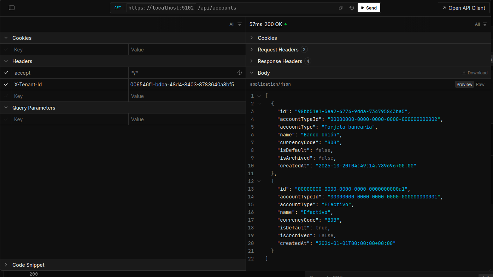
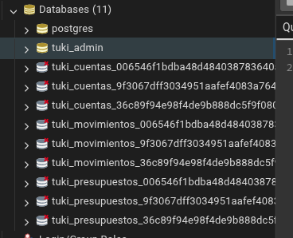
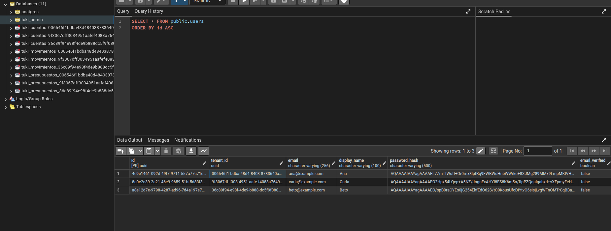
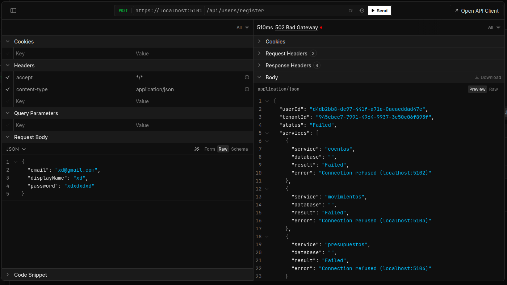
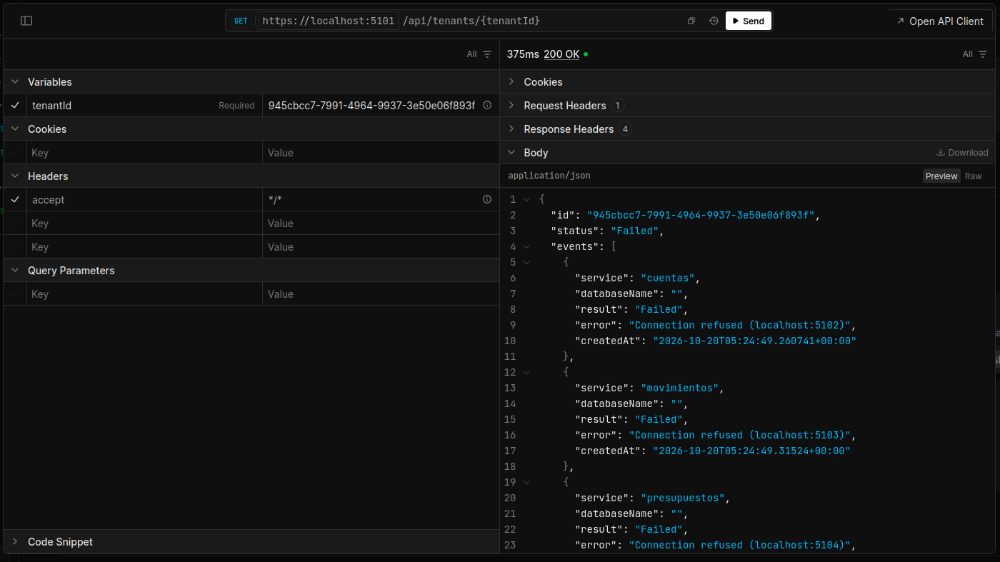
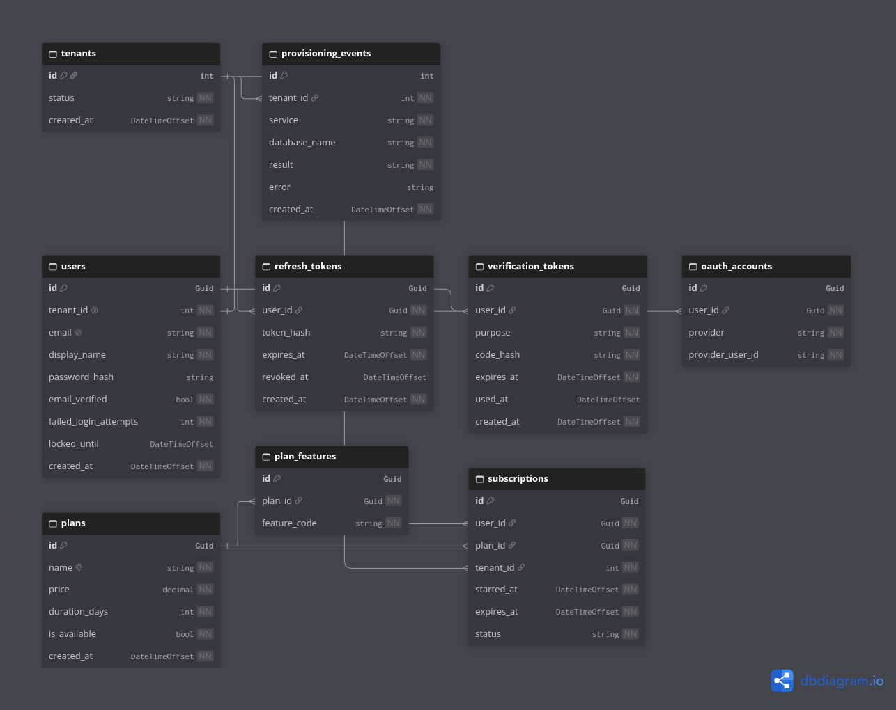
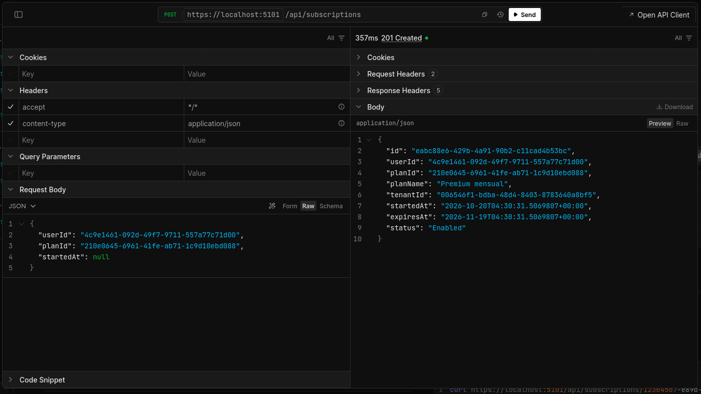
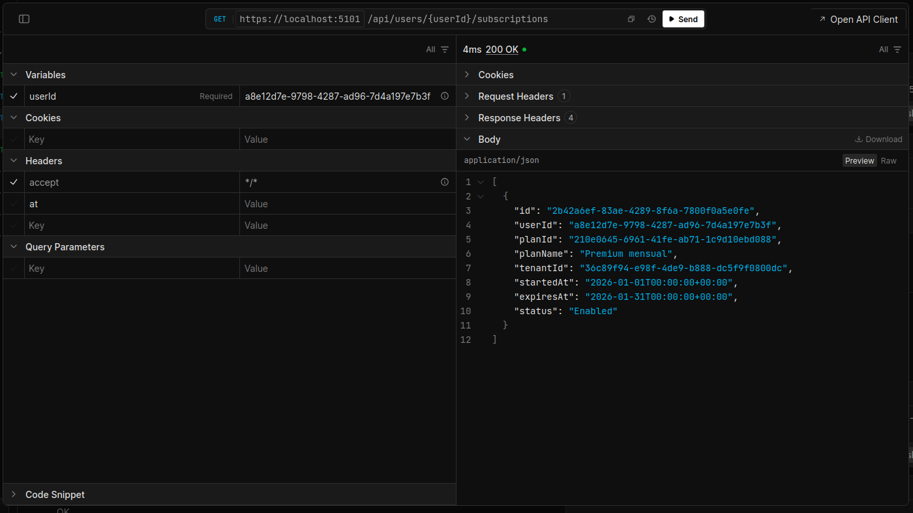

# Tarea 4: Microservicios de negocio, multitenencia y suscripciones

**Proyecto:** Tuki, aplicación de registro contable · **Autor:** Herberth · **Fecha:** 20 de octubre de 2026

## 1. Resumen

En la tarea 3 se diseñó el sistema. En esta tarea se implementa su parte central en el backend: un proyecto administrador y tres microservicios de negocio, donde cada microservicio trabaja con una base de datos propia por cada cliente (tenant). También se completan los planes de pago, las suscripciones y la consulta de vigencia.

| Punto                          | Qué se hizo                                                                                                   | Sección |
| ------------------------------ | ------------------------------------------------------------------------------------------------------------- | ------- |
| 1. Tres microservicios propios | Cuentas, Movimientos y Presupuestos, con entidades, DbContext, migración y controladores, aislados por tenant | 3       |
| 2. Bases por tenant            | Registro de usuario que crea el tenant y sus tres bases con el patrón `tuki_<servicio>_<tenantId>`            | 4       |
| 3. Planes y suscripciones      | Planes (crear, consultar y actualizar) y suscripción de usuarios con validaciones                             | 5       |
| 4. Estado del plan             | Endpoint que responde activa, vencida o inexistente a partir de las fechas y el estado                        | 6       |

La sección 8 indica con claridad lo que queda pendiente.

## 2. Arquitectura

El sistema se compone de un proyecto administrador, con una base de datos global, y tres microservicios de negocio. Cada microservicio de negocio tiene **una base de datos por tenant**, creada y migrada por el propio servicio. Los servicios se comunican por HTTPS y todos se conectan a PostgreSQL por el puerto 5432.


| Servicio      | Puerto | Responsabilidad                            | Base de datos                   |
| ------------- | ------ | ------------------------------------------ | ------------------------------- |
| Administrador | 5101   | Usuarios, tenants, planes y suscripciones  | `tuki_admin` (una sola, global) |
| Cuentas       | 5102   | Cuentas, tipos de cuenta y categorías      | `tuki_cuentas_{tenantId}`       |
| Movimientos   | 5103   | Transacciones, líneas, atajos y marcadores | `tuki_movimientos_{tenantId}`   |
| Presupuestos  | 5104   | Límites de gasto por categoría             | `tuki_presupuestos_{tenantId}`  |

Tecnologías: .NET 10 con controladores de ASP.NET Core, Entity Framework Core con Npgsql, convención de nombres `snake_case` y PostgreSQL. El identificador del tenant es un `Guid`, como en el ejemplo visto en clase.

## 3. Punto 1: microservicios de negocio propios

### 3.1 Responsabilidad, entidades y migraciones

| Servicio     | Entidades                                                                    | DbContext               | Migración                                                               | Controladores funcionales       |
| ------------ | ---------------------------------------------------------------------------- | ----------------------- | ----------------------------------------------------------------------- | ------------------------------- |
| Cuentas      | `account_types`, `accounts`, `categories`                                    | `CuentasDbContext`      | `InitialCreate`, que siembra cinco tipos de cuenta y la cuenta Efectivo | `accounts` e interno de tenants |
| Movimientos  | `transactions`, `transaction_lines`, `shortcuts`, `tags`, `transaction_tags` | `MovimientosDbContext`  | `InitialCreate`                                                         | `tags` e interno de tenants     |
| Presupuestos | `budgets`                                                                    | `PresupuestosDbContext` | `InitialCreate`                                                         | `budgets` e interno de tenants  |

Entre servicios no se comparten tablas ni hay claves foráneas. Cuando un servicio necesita referirse a datos de otro, guarda solo el identificador. Por ejemplo, `transaction_lines.account_id` apunta a una cuenta que vive en Cuentas.

### 3.2 Resolución del tenant en cada petición

Cada servicio usa la base del tenant de la solicitud, sin mezclar clientes:

1. La petición llega con el encabezado `X-Tenant-Id`.
2. Un middleware comprueba que sea un `Guid` válido. Si falta o no es válido, responde `400`.
3. El valor se guarda en `TenantContext`, que se crea una vez por petición (ciclo de vida _scoped_), así dos peticiones simultáneas de tenants distintos nunca se mezclan.
4. Cuando un controlador pide el `DbContext`, se construye en ese momento con la cadena de conexión de la base de ese tenant.

```csharp
builder.Services.AddScoped<TenantContext>();
builder.Services.AddDbContext<CuentasDbContext>((services, options) =>
{
    var tenant = services.GetRequiredService<TenantContext>();
    var conexiones = services.GetRequiredService<ConexionesTenant>();
    options.UseNpgsql(conexiones.CadenaConexion(tenant.TenantId))
        .UseSnakeCaseNamingConvention();
});
```

Las rutas internas (`/internal`) y la documentación de la API (`/scalar`, `/openapi`) quedan fuera del middleware, porque no pertenecen a un tenant.

### 3.3 Prueba de aislamiento

Se registraron dos usuarios (dos tenants) y se usó el mismo servicio con el encabezado de cada uno. En cada servicio se creó un dato solo en el tenant A y se comprobó que el tenant B no lo ve, ni siquiera consultándolo por su identificador.

| Servicio     | Dato creado en el tenant A                        | Lo que ve el tenant B                                         |
| ------------ | ------------------------------------------------- | ------------------------------------------------------------- |
| Cuentas      | Cuenta «Banco Unión»                              | Solo la cuenta Efectivo sembrada; `GET` por id responde `404` |
| Movimientos  | Marcador «Viaje»                                  | Lista vacía; `GET` por id responde `404`                      |
| Presupuestos | Dos presupuestos (una categoría y el gasto total) | Lista vacía; `GET` por id responde `404`                      |





## 4. Punto 2: bases por tenant

### 4.1 Patrón de nombres sin valores fijos

Todas las bases de negocio siguen exactamente el patrón `nombreproyecto_nombremicroservicio_tenantId`. El enunciado ejemplifica con un identificador numérico (`turnos_agenda_12`). Aquí el tenant se identifica con un `Guid`, escrito sin guiones (formato `N`).

| Servicio     | Base del tenant `3fa85f64-5717-4562-b3fc-2c963f66afa6` |
| ------------ | ------------------------------------------------------ |
| Cuentas      | `tuki_cuentas_3fa85f6457174562b3fc2c963f66afa6`        |
| Movimientos  | `tuki_movimientos_3fa85f6457174562b3fc2c963f66afa6`    |
| Presupuestos | `tuki_presupuestos_3fa85f6457174562b3fc2c963f66afa6`   |

El nombre se arma en un único lugar de cada servicio, la clase `ConexionesTenant`:

```csharp
public string NombreBase(Guid tenantId) => $"{_proyecto}_{_servicio}_{tenantId:N}";
```

- **Proyecto:** viene de la configuración (`Tuki__Proyecto` en el archivo `.env`).
- **Servicio:** lo define una constante en el `Program.cs` de cada servicio.
- **Tenant:** llega en la petición o en la URL del endpoint interno. Nunca está escrito en el código.
- **Credenciales y host de PostgreSQL:** también salen del `.env`, que no se sube al repositorio.
- **Validación:** el nombre del proyecto y del servicio solo admite minúsculas, números y guion bajo, porque `CREATE DATABASE` no admite parámetros. El nombre más largo posible tiene 50 caracteres, por debajo del límite de 63 de PostgreSQL.

### 4.2 Registro de usuario y creación de las bases

El endpoint `POST /api/users/register` del Administrador ahora crea el tenant y sus tres bases:

1. Comprueba que el correo no exista (`409` si ya existe).
2. Genera el `tenantId` y guarda el tenant (estado `Provisioning`) y el usuario, con la contraseña en hash.
3. Recorre los servicios de negocio configurados en el `.env` (`Tuki__Servicios__*`, menos el propio Administrador) y llama a cada uno.
4. Anota el resultado de cada servicio en la tabla `provisioning_events`: servicio, nombre de la base, resultado y error si lo hubo.
5. Si los tres respondieron bien, el tenant pasa a `Active` y responde `201`. Si alguno falló, queda en `Failed` y responde `502` con el detalle de cada servicio.

Agregar un servicio nuevo solo requiere una variable más en el `.env`.

### 4.3 Preparación de la base en cada servicio

Cada servicio expone `POST /internal/tenants/{tenantId}/database`, que solo llama el Administrador. El servicio comprueba si la base existe y ejecuta `MigrateAsync()`, que crea la base si falta y aplica las migraciones pendientes. Un bloqueo evita que dos llamadas simultáneas intenten crear la misma base a la vez.

| Situación                                                   | Respuesta del servicio                                    |
| ----------------------------------------------------------- | --------------------------------------------------------- |
| La base no existía y se creó                                | `201`, resultado `Created`                                |
| La base ya existía                                          | `200`, resultado `AlreadyExisted`, sin migraciones nuevas |
| Cualquier error (por ejemplo, sin permiso para crear bases) | `500` con el mensaje de error; no se informa éxito        |

### 4.4 Cómo se cumplen las reglas del enunciado

| Regla                                   | Cómo se cumple                                                                                                                                            |
| --------------------------------------- | --------------------------------------------------------------------------------------------------------------------------------------------------------- |
| Sin nombres ni `tenantId` fijos         | El proyecto y las credenciales salen de la configuración, el servicio de una constante y el tenant de la petición                                         |
| No duplicar bases existentes            | Si la base existe, `MigrateAsync` solo aplica lo que falte; la segunda llamada responde `AlreadyExisted`                                                  |
| No informar éxito si falla una creación | El tenant queda `Failed`, la respuesta es `502` y cada fallo queda registrado con su mensaje. Tampoco se considera éxito si no hay servicios configurados |
| Un tenant existente reutiliza sus bases | `POST /api/tenants/{tenantId}/provision` repite la preparación: reutiliza las bases que existen y crea solo las que faltan                                |

### 4.5 Demostración con dos tenants

Se registraron dos usuarios, Ana y Beto, y cada uno recibió su tenant y tres bases. Después se probó un fallo real: con el servicio Movimientos detenido se registró un tercer usuario.







## 5. Punto 3: planes de pago y suscripciones

### 5.1 Modelo



- **`plans`:** `id`, `name` (único), `price`, `duration_days`, `is_available` y `created_at`.
- **`subscriptions`:** `id`, `user_id`, `plan_id`, `tenant_id`, `started_at`, `expires_at` y `status` (`Enabled` o `Cancelled`).

La suscripción se relaciona por clave foránea con el usuario, el plan y el tenant, que están en la misma base. Ninguna relación borra en cascada, para no perder el historial. El estado «vencida» no se guarda: se calcula con la fecha (sección 6).

### 5.2 Endpoints

| Método y ruta                           | Qué hace                                                                     |
| --------------------------------------- | ---------------------------------------------------------------------------- |
| `POST /api/plans`                       | Crea un plan (`409` si el nombre ya existe, sin distinguir mayúsculas)       |
| `GET /api/plans`                        | Lista todos los planes                                                       |
| `GET /api/plans/available`              | Lista solo los planes disponibles, lo que ve un usuario antes de suscribirse |
| `GET /api/plans/{id}`                   | Consulta un plan                                                             |
| `PUT /api/plans/{id}`                   | Actualiza nombre, precio, duración y disponibilidad                          |
| `POST /api/subscriptions`               | Suscribe a un usuario a un plan                                              |
| `GET /api/subscriptions/{id}`           | Consulta una suscripción                                                     |
| `GET /api/users/{userId}/subscriptions` | Lista las suscripciones de un usuario                                        |
| `POST /api/subscriptions/{id}/cancel`   | Cancela una suscripción                                                      |

Un plan no se borra: cuando deja de ofrecerse se pone `isAvailable` en `false`, y las suscripciones que ya lo usaban siguen siendo válidas.

### 5.3 Validaciones al suscribirse

| Orden | Validación                                                              | Respuesta si falla |
| ----- | ----------------------------------------------------------------------- | ------------------ |
| 1     | El usuario existe                                                       | `404`              |
| 2     | El plan existe                                                          | `404`              |
| 3     | El plan admite nuevas suscripciones (`isAvailable`)                     | `409`              |
| 4     | La fecha de inicio no es futura y el vencimiento es posterior al inicio | `400`              |
| 5     | El usuario no tiene ya una suscripción activa                           | `409`              |

Los errores de formato (precio negativo, nombre vacío, duración fuera de rango) se rechazan con `400` mediante validación del modelo.

### 5.4 Decisiones de diseño

- **El vencimiento se calcula:** es `inicio + duración del plan`. El cliente no envía fechas, así que no pueden ser contradictorias.
- **El inicio es opcional:** si no se envía, la suscripción empieza ahora. Un inicio pasado permite demostrar una suscripción vencida sin esperar días.
- **El tenant sale del usuario,** no de la petición, para que una suscripción nunca quede con un tenant que no le corresponde.
- **Una suscripción activa por usuario:** se puede volver a suscribir cuando la anterior venció o se canceló.
- **Sin pasarela de pago:** no se realizan cobros, como indica el enunciado.



## 6. Punto 4: estado del plan, activo o vencido

### 6.1 Endpoint

`GET /api/users/{userId}/subscription-status` recibe el identificador del usuario y devuelve su plan, tenant, inicio, vencimiento y el resultado. Un usuario inexistente responde `404`. El parámetro opcional `at` permite consultar «como si fuera» una fecha concreta; se usa para demostrar los límites sin esperar y, si no se envía, se usa la hora actual.

```json
{
  "userId": "a8e12d7e-9798-4287-ad96-7d4a197e7b3f",
  "result": "Expired",
  "reason": "La suscripción venció el 2026-01-31 00:00 UTC.",
  "plan": "Premium mensual",
  "tenantId": "36c89f94-e98f-4de9-b888-dc5f9f0800dc",
  "startedAt": "2026-01-01T00:00:00+00:00",
  "expiresAt": "2026-01-31T00:00:00+00:00",
  "status": "Enabled",
  "checkedAt": "2026-01-31T00:00:00+00:00"
}
```

### 6.2 Regla de vigencia

La vigencia se calcula con la fecha actual, el inicio, el vencimiento y el estado, y no con un booleano guardado. Todo se evalúa en UTC y el reloj se lee una sola vez por petición. Una suscripción está activa cuando:

> el estado es `Enabled` **y** `inicio <= ahora < vencimiento`

El vencimiento queda excluido: en el instante exacto del vencimiento la suscripción deja de estar activa.

La respuesta trae dos campos que no significan lo mismo:

| Campo    | Qué es                                              | Valores                            |
| -------- | --------------------------------------------------- | ---------------------------------- |
| `status` | Estado guardado en la base; no cambia con el tiempo | `Enabled`, `Cancelled`             |
| `result` | Resultado calculado con la fecha                    | `Active`, `Expired`, `NonExistent` |

Por eso una suscripción puede tener `status` `Enabled` y `result` `Expired` a la vez. Si el usuario tiene varias suscripciones, se evalúa la activa y, si no hay ninguna, la más reciente. Se devuelven solo las suscripciones del usuario consultado. Una suscripción cancelada se informa como `Expired`, con el motivo en `reason`, porque el enunciado define solo tres resultados.

### 6.3 Casos demostrados

| Caso                      | Usuario                                     | `result`      | Motivo                                                 |
| ------------------------- | ------------------------------------------- | ------------- | ------------------------------------------------------ |
| Plan activo               | Ana, plan Premium mensual recién contratado | `Active`      | Vigente hasta la fecha de vencimiento                  |
| Plan vencido              | Beto, inicio 2026-01-01, 30 días            | `Expired`     | Venció el 2026-01-31 00:00 UTC                         |
| Sin suscripción           | Carla                                       | `NonExistent` | No tiene suscripciones; se informa igual su `tenantId` |
| Límite, un segundo antes  | Beto con `at=2026-01-30T23:59:59Z`          | `Active`      | Todavía es anterior al vencimiento                     |
| Límite, en el vencimiento | Beto con `at=2026-01-31T00:00:00Z`          | `Expired`     | El vencimiento queda excluido                          |
| Cancelada                 | Ana tras cancelar                           | `Expired`     | La suscripción fue cancelada                           |
| Usuario inexistente       | Un identificador inventado                  | `404`         | El usuario no existe                                   |



## 7. Cómo ejecutar el proyecto

Requisitos: SDK de .NET 10, Node.js, PostgreSQL y el certificado HTTPS de desarrollo (los pasos están en el `README.md`).

1. Crear el usuario de PostgreSQL con permiso para crear bases (`CREATEDB`).
2. Copiar `.env.example` como `.env` y completar la contraseña.
3. Desde la raíz del repositorio, ejecutar `npm install` y después `npm run dev`. Un solo comando levanta el Gateway y los cuatro servicios.
4. Probar cada API en el navegador. La documentación interactiva (Scalar) está en `https://localhost:<puerto>/scalar`, con el puerto de la tabla de la sección 2. En los servicios de negocio se debe agregar el encabezado `X-Tenant-Id` a cada petición.

En Ubuntu, si `dotnet watch` se detiene por el límite de `inotify`, se sube con `fs.inotify.max_user_instances=512`.

## 8. Limitaciones y trabajo pendiente

- **Controladores de negocio:** hoy hay un recurso funcional por servicio (`accounts`, `tags` y `budgets`) para demostrar el aislamiento por tenant. El resto de las entidades ya tiene su tabla y su migración, pero todavía no su controlador: categorías, tipos de cuenta, transacciones y líneas, atajos, asignación de marcadores y la edición de presupuestos.
- **Validación entre servicios:** los identificadores de otros servicios (por ejemplo, la categoría de un presupuesto o la cuenta de una línea) todavía no se comprueban por HTTP.
- **Gateway y app móvil:** el Gateway está creado, pero todavía no reenvía peticiones, y la app móvil no está implementada. Hoy los servicios se llaman directamente.
- **Administrador:** solo se implementaron `users`, `tenants`, `provisioning_events`, `plans` y `subscriptions`. Las tablas de sesiones, verificación de correo, cuentas de Google y funciones por plan siguen como diseño. No hay inicio de sesión, por eso el `userId` viaja en el cuerpo de la petición.
- **Cancelar una suscripción:** la implementación la deja inactiva de inmediato, como exige el enunciado. El caso de uso CU-SUS-03 describía que conservaba el acceso hasta el fin del período.
- **Datos iniciales:** solo se siembran los tipos de cuenta y la cuenta Efectivo. El conjunto base de categorías no está definido.
- **Identificadores:** hoy los genera el servidor. El diseño prevé que los genere el cliente, para la sincronización sin conexión.
- **Pagos:** no se integra pasarela de pago ni se realizan cobros, como indica el enunciado.
