## Contenido

1. [Diagrama de base de datos normalizado en 5FN](#1-diagrama-de-base-de-datos-normalizado-en-5fn)
2. [Diagrama de despliegue](#2-diagrama-de-despliegue)
3. [Diagramas de casos de uso](#3-diagramas-de-casos-de-uso)
4. [Historias de usuario](#4-historias-de-usuario)
5. [Priorización y detalle de las historias del MVP](#5-priorización-y-detalle-de-las-historias-del-mvp)
6. [Wireframes](#6-wireframes)

## Resumen del producto

Tuki ayuda a llevar la contabilidad personal de forma meticulosa y rápida. Se diferencia de la app «Registro contable» de la Play Store en tres puntos: registrar un gasto toma uno o dos toques gracias a los atajos, las personas son cuentas con saldo con signo (para saber quién le debe a quién) y todo es personalizable.

Decisiones que condicionan todo el diseño:

- **Multitenencia con el modelo Silo:** cada usuario tiene su propio espacio (tenant) con una base de datos independiente.
- **Microservicios .NET** (Identidad, Tenants, Contabilidad y Suscripciones) detrás de un Gateway YARP. Cada servicio tiene su base.
- **Despliegue local**, sin Docker, Kubernetes ni servicios de nube para el backend.
- **App móvil en React Native.** El backend es la prioridad; la app se presenta como complemento.

Documentos de apoyo en el repositorio: [00-resumen-levantamiento.md](00-resumen-levantamiento.md), [casos-de-uso.md](casos-de-uso.md), [historias-de-usuario.md](historias-de-usuario.md) y [priorizacion-mvp.md](priorizacion-mvp.md).

## 1. Diagrama de base de datos normalizado en 5FN

### 1.1 Principios de diseño

- **Una base por servicio, y una base por tenant.** Identidad, Tenants y Suscripciones tienen cada uno una base compartida por todos los usuarios. Contabilidad no tiene una sola base: tiene una por tenant (modelo Silo), todas con el mismo esquema.
- **Claves foráneas solo dentro de una misma base.** Entre servicios únicamente se comparten identificadores (por ejemplo tenant_id) y se consulta por API con HttpClient.
- **Las bases se crean desde el código.** Las clases C# con Entity Framework Core generan las migraciones; nadie crea tablas a mano. Los nombres en la base siguen la convención snake_case.
- **Los identificadores son Guid**, para que no sean predecibles al viajar entre servicios y para que el cliente pueda generarlos.
- **Lo que se puede calcular no se guarda.** Los saldos de las cuentas y el gasto de un presupuesto salen de sumar las líneas de los movimientos, así no existe un dato derivado que pueda desincronizarse.
- **Archivar en lugar de borrar.** Las cuentas, categorías, atajos y demás elementos con historial se archivan para no romper los movimientos ya registrados.

### 1.2 Propiedad de la información por microservicio

| Información                                                                   | Servicio propietario | Base de datos                     |
| ----------------------------------------------------------------------------- | -------------------- | --------------------------------- |
| Usuarios, credenciales, sesiones, verificación de correo y vínculo con Google | Identidad            | identity_db (una para todos)      |
| Catálogo de tenants: qué espacios existen, su estado y el nombre de su base   | Tenants              | tenants_db (una para todos)       |
| Planes, funciones de cada plan y suscripción de cada tenant                   | Suscripciones        | subscriptions_db (una para todos) |
| Cuentas, personas, categorías, movimientos, atajos, presupuestos y marcadores | Contabilidad         | tenant\_<id> (**una por tenant**) |

### 1.3 Identificadores compartidos entre servicios

Estas columnas guardan un identificador de otro servicio. No son claves foráneas, porque apuntan a otra base de datos.

| Columna                 | Está en       | Apunta a                  | Quién lo genera                            |
| ----------------------- | ------------- | ------------------------- | ------------------------------------------ |
| users.tenant_id         | Identidad     | tenants.id en Tenants     | Identidad, al registrar al usuario         |
| tenants.id              | Tenants       | Es el mismo identificador | Llega desde Identidad por API              |
| tenants.owner_user_id   | Tenants       | users.id en Identidad     | Llega desde Identidad por API              |
| subscriptions.tenant_id | Suscripciones | tenants.id en Tenants     | Llega por API cuando se registra el tenant |

Los datos contables no llevan tenant_id ni user_id: toda la base pertenece a un solo tenant, y esa columna sería redundante.

### 1.4 Identidad (identity_db)

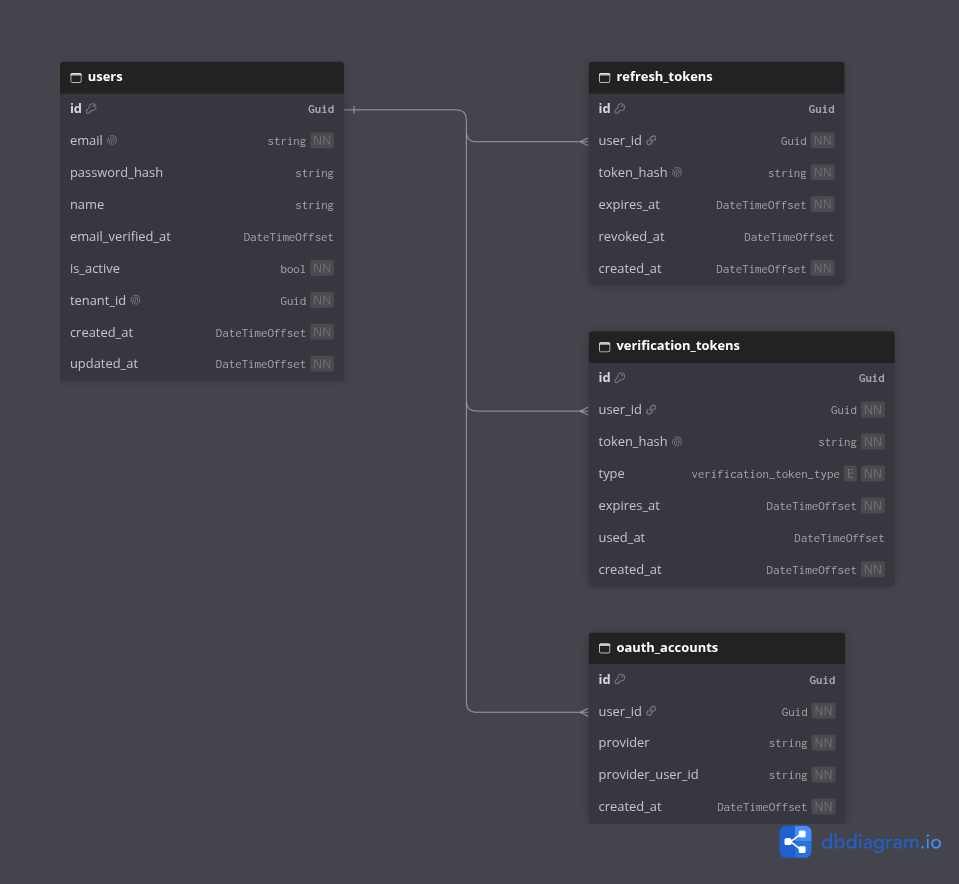

Fuente: [diagrams/db/identity.dbml](diagrams/db/identity.dbml)

**users:** la persona registrada.

| Atributo               | Tipo           | Clave         | Descripción                               |
| ---------------------- | -------------- | ------------- | ----------------------------------------- |
| id                     | Guid           | PK            | Identificador del usuario                 |
| email                  | string         | Única         | Identificador de inicio de sesión         |
| password_hash          | string         |               | Nulo si solo entra con Google             |
| name                   | string         |               | Nombre para mostrar (opcional)            |
| email_verified_at      | DateTimeOffset |               | Nulo mientras el correo no se verifique   |
| is_active              | bool           |               | Permite deshabilitar el acceso sin borrar |
| tenant_id              | Guid           | Única, sin FK | Tenant del usuario (en Tenants)           |
| created_at, updated_at | DateTimeOffset |               | Auditoría y preparación para sincronizar  |

**refresh_tokens:** sesiones de larga duración.

| Atributo   | Tipo           | Clave         | Descripción                          |
| ---------- | -------------- | ------------- | ------------------------------------ |
| id         | Guid           | PK            |                                      |
| user_id    | Guid           | FK → users.id | Dueño de la sesión                   |
| token_hash | string         | Única         | Solo se guarda el hash               |
| expires_at | DateTimeOffset |               |                                      |
| revoked_at | DateTimeOffset |               | Nulo mientras la sesión está vigente |
| created_at | DateTimeOffset |               |                                      |

**verification_tokens:** códigos para verificar el correo y recuperar la contraseña.

| Atributo   | Tipo           | Clave         | Descripción                         |
| ---------- | -------------- | ------------- | ----------------------------------- |
| id         | Guid           | PK            |                                     |
| user_id    | Guid           | FK → users.id |                                     |
| token_hash | string         | Única         |                                     |
| type       | enum           |               | email_verification o password_reset |
| expires_at | DateTimeOffset |               |                                     |
| used_at    | DateTimeOffset |               | Nulo si el código no se ha usado    |
| created_at | DateTimeOffset |               |                                     |

**oauth_accounts:** vínculo con proveedores externos (por ahora Google).

| Atributo         | Tipo           | Clave                      | Descripción                                 |
| ---------------- | -------------- | -------------------------- | ------------------------------------------- |
| id               | Guid           | PK                         |                                             |
| user_id          | Guid           | FK → users.id              |                                             |
| provider         | string         | Única con provider_user_id | Por ahora «Google»                          |
| provider_user_id | string         | Única con provider         | Identificador de la persona en el proveedor |
| created_at       | DateTimeOffset |                            |                                             |

**Cardinalidades:** un users tiene de 0 a N refresh_tokens, de 0 a N verification_tokens y de 0 a N oauth_accounts. Cada fila hija pertenece a un solo usuario.

### 1.5 Tenants (tenants_db)

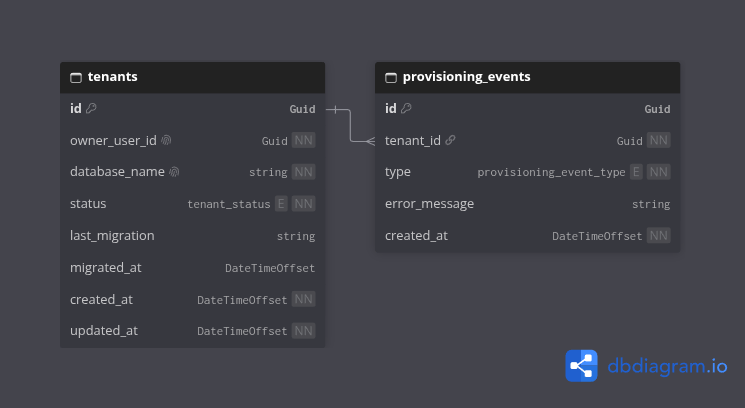

Fuente: [diagrams/db/tenants.dbml](diagrams/db/tenants.dbml)

**tenants:** el catálogo de espacios.

| Atributo               | Tipo           | Clave         | Descripción                                            |
| ---------------------- | -------------- | ------------- | ------------------------------------------------------ |
| id                     | Guid           | PK            | No se autogenera: lo crea Identidad y llega por API    |
| owner_user_id          | Guid           | Única, sin FK | Usuario propietario (en Identidad)                     |
| database_name          | string         | Única         | Nombre de la base física del tenant, derivado de su id |
| status                 | enum           |               | pending, provisioning, active, failed o suspended      |
| last_migration         | string         |               | Última migración aplicada a la base del tenant         |
| migrated_at            | DateTimeOffset |               | Momento de esa migración                               |
| created_at, updated_at | DateTimeOffset |               |                                                        |

**provisioning_events:** historial de la creación y migración de cada base.

| Atributo      | Tipo           | Clave           | Descripción                                               |
| ------------- | -------------- | --------------- | --------------------------------------------------------- |
| id            | Guid           | PK              |                                                           |
| tenant_id     | Guid           | FK → tenants.id |                                                           |
| type          | enum           |                 | database_created, migration_applied o provisioning_failed |
| error_message | string         |                 | Solo se llena cuando el tipo es un fallo                  |
| created_at    | DateTimeOffset |                 |                                                           |

**Cardinalidades:** un tenants tiene de 0 a N provisioning_events.

El servidor de PostgreSQL (host, puerto y credenciales) no se guarda en el catálogo: es el mismo para todos en el despliegue local y sale de la configuración del servicio.

### 1.6 Contabilidad (una base por tenant: tenant\_<id>)

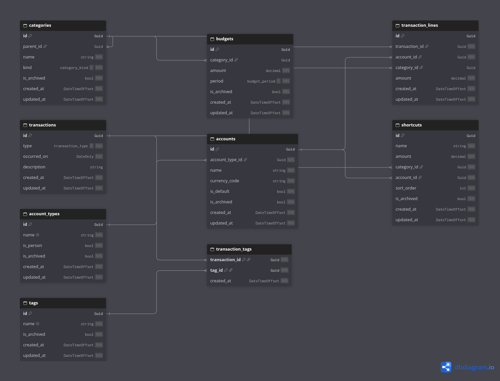

Fuente: [diagrams/db/accounting.dbml](diagrams/db/accounting.dbml)

**account_types:** tipos de cuenta personalizables.

| Atributo               | Tipo           | Clave | Descripción                                                              |
| ---------------------- | -------------- | ----- | ------------------------------------------------------------------------ |
| id                     | Guid           | PK    |                                                                          |
| name                   | string         | Única | Efectivo, tarjeta bancaria, cuenta digital, otro, persona o uno propio   |
| is_person              | bool           |       | Indica que las cuentas de este tipo son personas (deudores o acreedores) |
| is_archived            | bool           |       |                                                                          |
| created_at, updated_at | DateTimeOffset |       |                                                                          |

**accounts:** cuentas propias y personas.

| Atributo               | Tipo           | Clave                 | Descripción                 |
| ---------------------- | -------------- | --------------------- | --------------------------- |
| id                     | Guid           | PK                    |                             |
| account_type_id        | Guid           | FK → account_types.id |                             |
| name                   | string         |                       |                             |
| currency_code          | string         |                       | Fijo en BOB durante la beta |
| is_default             | bool           |                       | Marca la cuenta «Efectivo»  |
| is_archived            | bool           |                       |                             |
| created_at, updated_at | DateTimeOffset |                       |                             |

**categories:** categorías y subcategorías (dos niveles).

| Atributo               | Tipo           | Clave              | Descripción                                  |
| ---------------------- | -------------- | ------------------ | -------------------------------------------- |
| id                     | Guid           | PK                 |                                              |
| parent_id              | Guid           | FK → categories.id | Nulo en una categoría raíz (autorreferencia) |
| name                   | string         |                    |                                              |
| kind                   | enum           |                    | expense o income                             |
| is_archived            | bool           |                    |                                              |
| created_at, updated_at | DateTimeOffset |                    |                                              |

**transactions:** el evento completo de un movimiento.

| Atributo               | Tipo           | Clave | Descripción                                         |
| ---------------------- | -------------- | ----- | --------------------------------------------------- |
| id                     | Guid           | PK    |                                                     |
| type                   | enum           |       | expense, income, transfer u opening (saldo inicial) |
| occurred_on            | DateOnly       |       | Fecha del movimiento                                |
| description            | string         |       | Opcional; alimenta el autocompletado                |
| created_at, updated_at | DateTimeOffset |       |                                                     |

**transaction_lines:** cada reparto de un movimiento.

| Atributo               | Tipo           | Clave                | Descripción                              |
| ---------------------- | -------------- | -------------------- | ---------------------------------------- |
| id                     | Guid           | PK                   |                                          |
| transaction_id         | Guid           | FK → transactions.id |                                          |
| account_id             | Guid           | FK → accounts.id     | Cuenta o persona afectada                |
| category_id            | Guid           | FK → categories.id   | Nulo en traslados y aperturas            |
| amount                 | decimal        |                      | Con signo: el cambio que sufre la cuenta |
| created_at, updated_at | DateTimeOffset |                      |                                          |

**shortcuts:** atajos de gastos rutinarios.

| Atributo               | Tipo           | Clave              | Descripción                    |
| ---------------------- | -------------- | ------------------ | ------------------------------ |
| id                     | Guid           | PK                 |                                |
| name                   | string         |                    |                                |
| amount                 | decimal        |                    |                                |
| category_id            | Guid           | FK → categories.id |                                |
| account_id             | Guid           | FK → accounts.id   |                                |
| sort_order             | int            |                    | Orden en la pantalla principal |
| is_archived            | bool           |                    |                                |
| created_at, updated_at | DateTimeOffset |                    |                                |

**budgets:** límites de gasto por período.

| Atributo               | Tipo           | Clave                 | Descripción                                |
| ---------------------- | -------------- | --------------------- | ------------------------------------------ |
| id                     | Guid           | PK                    |                                            |
| category_id            | Guid           | FK → categories.id    | Nulo significa presupuesto del gasto total |
| amount                 | decimal        |                       | Límite de gasto                            |
| period                 | enum           | Única con category_id | Por ahora monthly                          |
| is_archived            | bool           |                       |                                            |
| created_at, updated_at | DateTimeOffset |                       |                                            |

**tags:** marcadores o etiquetas libres.

| Atributo               | Tipo           | Clave | Descripción |
| ---------------------- | -------------- | ----- | ----------- |
| id                     | Guid           | PK    |             |
| name                   | string         | Única |             |
| is_archived            | bool           |       |             |
| created_at, updated_at | DateTimeOffset |       |             |

**transaction_tags:** relación muchos a muchos entre transacciones y marcadores.

| Atributo       | Tipo           | Clave                              | Descripción |
| -------------- | -------------- | ---------------------------------- | ----------- |
| transaction_id | Guid           | PK compuesta, FK → transactions.id |             |
| tag_id         | Guid           | PK compuesta, FK → tags.id         |             |
| created_at     | DateTimeOffset |                                    |             |

**Cardinalidades**

| Relación                                      | Cardinalidad             |
| --------------------------------------------- | ------------------------ |
| account_types → accounts                      | 1 a N                    |
| categories → categories (padre e hijas)       | 1 a N, opcional          |
| transactions → transaction_lines              | 1 a N (mínimo una línea) |
| accounts → transaction_lines                  | 1 a N                    |
| categories → transaction_lines                | 1 a N, opcional          |
| categories → shortcuts                        | 1 a N                    |
| accounts → shortcuts                          | 1 a N                    |
| categories → budgets                          | 1 a N, opcional          |
| transactions ↔ tags mediante transaction_tags | N a N                    |

**Cómo se representan los movimientos.** El monto de cada línea es el cambio que sufre su cuenta, y el saldo de una cuenta es la suma de sus líneas. Con el ejemplo del cine:

| Transacción                | Tipo     | Cuenta   | Categoría | Monto |
| -------------------------- | -------- | -------- | --------- | ----- |
| Entrada del amigo          | traslado | Efectivo | (ninguna) | −40   |
|                            |          | Amigo    | (ninguna) | +40   |
| Comida pagada por el amigo | gasto    | Amigo    | Comida    | −25   |

El amigo queda en +15 (le debe 15 al usuario). Un pago parcial de esa deuda es otro traslado.

### 1.7 Suscripciones (subscriptions_db)

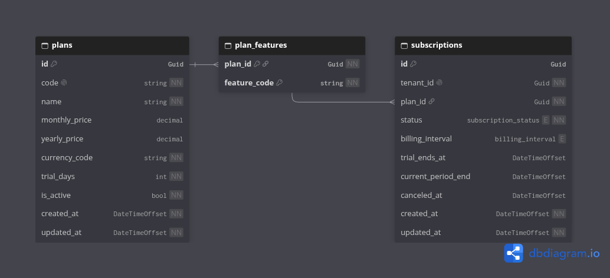

Fuente: [diagrams/db/subscriptions.dbml](diagrams/db/subscriptions.dbml). Este módulo se diseña pero no se implementa en la beta.

**plans:** planes ofrecidos.

| Atributo               | Tipo           | Clave | Descripción                           |
| ---------------------- | -------------- | ----- | ------------------------------------- |
| id                     | Guid           | PK    |                                       |
| code                   | string         | Única | Identificador estable (free, premium) |
| name                   | string         |       |                                       |
| monthly_price          | decimal        |       | Nulo en el plan Gratis                |
| yearly_price           | decimal        |       | Nulo en el plan Gratis                |
| currency_code          | string         |       | BOB en la beta                        |
| trial_days             | int            |       | 0 si el plan no ofrece prueba         |
| is_active              | bool           |       |                                       |
| created_at, updated_at | DateTimeOffset |       |                                       |

**plan_features:** funciones que incluye cada plan.

| Atributo     | Tipo   | Clave                       | Descripción                 |
| ------------ | ------ | --------------------------- | --------------------------- |
| plan_id      | Guid   | PK compuesta, FK → plans.id |                             |
| feature_code | string | PK compuesta                | Por ejemplo receipt_scanner |

**subscriptions:** la suscripción vigente de cada tenant.

| Atributo               | Tipo           | Clave         | Descripción                              |
| ---------------------- | -------------- | ------------- | ---------------------------------------- |
| id                     | Guid           | PK            |                                          |
| tenant_id              | Guid           | Única, sin FK | Tenant (en Tenants)                      |
| plan_id                | Guid           | FK → plans.id |                                          |
| status                 | enum           |               | trial, active, grace, canceled o expired |
| billing_interval       | enum           |               | monthly o yearly; nulo en el plan Gratis |
| trial_ends_at          | DateTimeOffset |               |                                          |
| current_period_end     | DateTimeOffset |               |                                          |
| canceled_at            | DateTimeOffset |               |                                          |
| created_at, updated_at | DateTimeOffset |               |                                          |

**Cardinalidades:** plans 1 a N plan_features; plans 1 a N subscriptions; cada tenant tiene una sola suscripción vigente.

### 1.8 Modelo Silo: bases independientes por tenant

En el modelo Silo cada tenant tiene su propia base de datos física. Contabilidad usa el mismo esquema (las 9 tablas de la sección 1.6) para todos, pero aplicado a una base distinta por cada tenant.

| Base             | Servicio      | Contenido                              |
| ---------------- | ------------- | -------------------------------------- |
| identity_db      | Identidad     | Todos los usuarios                     |
| tenants_db       | Tenants       | El catálogo de todos los tenants       |
| subscriptions_db | Suscripciones | Planes y la suscripción de cada tenant |
| tenant_A         | Contabilidad  | Solo los datos contables del tenant A  |
| tenant_B         | Contabilidad  | Solo los datos contables del tenant B  |

Ejemplo con dos usuarios. Ana pertenece al tenant A y Luis al tenant B:

| users.email      | users.tenant_id | tenants.id | tenants.database_name |
| ---------------- | --------------- | ---------- | --------------------- |
| ana@ejemplo.com  | A               | A          | tenant_A              |
| luis@ejemplo.com | B               | B          | tenant_B              |

Ana y Luis pueden tener una cuenta llamada «Efectivo» y una categoría «Comida», y son filas distintas en bases distintas: ninguna consulta de Ana puede ver datos de Luis, porque Contabilidad solo se conecta a la base del tenant que indica el token. Las claves foráneas de la sección 1.6 relacionan siempre tablas de la misma base. Los nombres reales de las bases se derivan del identificador del tenant (tenant\_<id>).

### 1.9 Justificación de la normalización hasta la quinta forma normal

#### Primera forma normal (1FN)

Todas las columnas guardan valores atómicos y no hay grupos repetidos. Donde una entidad podía tener una lista de valores, la lista se separó en su propia tabla: los vínculos con Google en oauth_accounts (en lugar de columnas repetidas en users), las funciones de un plan en plan_features, los marcadores de un movimiento en transaction_tags y las líneas de un movimiento en transaction_lines.

#### Segunda forma normal (2FN)

Casi todas las tablas tienen una clave primaria de una sola columna (id), así que ningún atributo puede depender de solo una parte de la clave. Las dos tablas con clave compuesta (plan_features y transaction_tags) no tienen atributos que dependan de una sola parte: feature_code forma parte de la clave y created_at depende del par completo.

El caso que sí obligó a descomponer fue el de los movimientos. Si el evento y sus repartos estuvieran en una sola tabla, la fecha, el tipo y la descripción se repetirían en cada línea y dependerían solo de la transacción, no de la línea completa. Por eso se separaron en transactions y transaction_lines.

#### Tercera forma normal (3FN) y Boyce-Codd (BCNF)

Ningún atributo que no es clave depende de otro atributo que tampoco es clave, y todo determinante es una clave candidata.

- is_person describe al tipo de cuenta, no a la cuenta. Si estuviera en accounts, dependería de account_type_id (una dependencia transitiva), así que vive en account_types.
- El precio mensual y el anual dependen solo del plan, y por eso están en plans.
- El saldo de una cuenta, el gasto de un presupuesto y los totales del resumen no se guardan: se calculan, para no crear atributos que dependan de otras filas.

#### Cuarta forma normal (4FN): dependencias multivaluadas

Una dependencia multivaluada aparece cuando una entidad tiene dos listas independientes entre sí dentro de la misma tabla. El caso real de este modelo es la transacción, que tiene dos conjuntos independientes: sus líneas y sus marcadores. Si ambos estuvieran en una sola tabla (transaction_id, line, tag), habría que repetir cada marcador por cada línea (un producto cruzado), y agregar un marcador obligaría a insertar tantas filas como líneas tenga la transacción. Se descompone en transaction_lines y transaction_tags, que cumplen 4FN porque cada una guarda una sola lista.

El mismo razonamiento aplica a users: los vínculos con proveedores, los tokens de sesión y los códigos de verificación son listas independientes, y cada una está en su tabla.

#### Quinta forma normal (5FN): dependencias de reunión

Una tabla está en 5FN si no se puede descomponer en tablas más pequeñas que, al reunirse, reconstruyan exactamente la original, salvo que esa reunión ya esté implicada por las claves.

- **Tablas con claves simples.** Todas las claves candidatas de users, tenants, plans, subscriptions, refresh_tokens, verification_tokens, provisioning_events, account_types, accounts, categories, transactions, transaction_lines, shortcuts, budgets y tags se componen de una sola columna, y las tablas están en 3FN. Una tabla en 3FN cuyas claves candidatas son simples cumple 5FN, porque cualquier dependencia de reunión queda implicada por esas claves.
- **transaction_lines es el caso que más lo merece.** Una línea relaciona una transacción, una cuenta y una categoría con un monto. Podría pensarse en separarla en (transacción, cuenta), (transacción, categoría) y (cuenta, categoría), pero esa reunión genera filas falsas. Si una compra de 60 Bs tiene la línea (Efectivo, Comida, 45) y la línea (Banco, Limpieza, 15), las proyecciones darían también (Efectivo, Limpieza) y (Banco, Comida), que no existen. Además el monto depende de las tres columnas juntas. Por lo tanto no hay una descomposición sin pérdida y la tabla ya está en 5FN.
- **plan_features** tiene solo dos atributos, ambos clave. Una tabla de dos columnas no admite una dependencia de reunión que no sea trivial.
- **transaction_tags** guarda un par (transacción, marcador) y su fecha de creación, que depende del par completo. No se puede descomponer sin perder la fecha, así que ya está en 5FN.
- **oauth_accounts y budgets** tienen una clave compuesta única además de su id. En ambas, el resto de columnas dependen de esa clave y no hay hechos independientes que justifiquen otra tabla.

#### Descomposiciones sin pérdida

Cada separación se puede deshacer con una unión por la clave, sin perder ni inventar datos:

| Descomposición                         | Se recupera con                     |
| -------------------------------------- | ----------------------------------- |
| transactions + transaction_lines       | Unión por transaction_id            |
| accounts + account_types               | Unión por account_type_id           |
| users + oauth_accounts                 | Unión por user_id                   |
| plans + plan_features                  | Unión por plan_id                   |
| transactions + transaction_tags + tags | Uniones por transaction_id y tag_id |

#### Verificación tabla por tabla

| Tabla               | Claves candidatas                | Por qué no necesita otra descomposición                                     |
| ------------------- | -------------------------------- | --------------------------------------------------------------------------- |
| users               | id, email, tenant_id             | Cada atributo describe al usuario; ninguno determina a otro                 |
| refresh_tokens      | id, token_hash                   | Describe una sola sesión; las sesiones de un usuario son filas, no columnas |
| verification_tokens | id, token_hash                   | Igual que la anterior; el tipo distingue los usos                           |
| oauth_accounts      | id, (provider, provider_user_id) | Un vínculo es un hecho único; no hay dos listas independientes              |
| tenants             | id, owner_user_id, database_name | Todos los atributos describen al tenant                                     |
| provisioning_events | id                               | Cada fila es un evento; el mensaje de error solo aplica al tipo de fallo    |
| plans               | id, code                         | Los dos precios dependen solo del plan                                      |
| plan_features       | (plan_id, feature_code)          | Relación binaria pura                                                       |
| subscriptions       | id, tenant_id                    | El estado y el intervalo describen a la suscripción                         |
| account_types       | id, name                         | is_person depende del tipo                                                  |
| accounts            | id                               | Lo que depende del tipo está en account_types                               |
| categories          | id                               | La autorreferencia no repite atributos del padre                            |
| transactions        | id                               | Solo datos del evento; lo variable está en las líneas y los marcadores      |
| transaction_lines   | id                               | Hecho atómico, sin descomposición sin pérdida                               |
| shortcuts           | id                               | Describe al atajo; no se enlaza a los gastos que genera                     |
| budgets             | id, (category_id, period)        | Los atributos dependen de la categoría y el período                         |
| tags                | id, name                         | Un solo atributo descriptivo                                                |
| transaction_tags    | (transaction_id, tag_id)         | Relación binaria con su fecha                                               |

#### Redundancias eliminadas y redundancias controladas

**Eliminadas:** los datos del evento repetidos en cada línea, los atributos del tipo de cuenta repetidos en cada cuenta, las columnas de proveedores repetidas en el usuario y los saldos y totales almacenados.

**Controladas.** Quedan pocas redundancias y todas son deliberadas:

- tenants.database_name se puede derivar del identificador del tenant, pero se guarda para que el catálogo sea la fuente explícita de dónde vive cada base.
- tenants.last_migration copia el dato que EF Core guarda en \_\_EFMigrationsHistory dentro de cada base de tenant; permite saber qué tenants están desactualizados sin conectarse a cada una.
- users.tenant_id, tenants.owner_user_id y subscriptions.tenant_id repiten identificadores entre servicios. No es una violación de la normalización: es la forma de relacionar servicios sin claves foráneas entre bases.
- currency_code es una constante (bolivianos) por ahora; está para que agregar monedas no obligue a rehacer el modelo.

## 2. Diagrama de despliegue

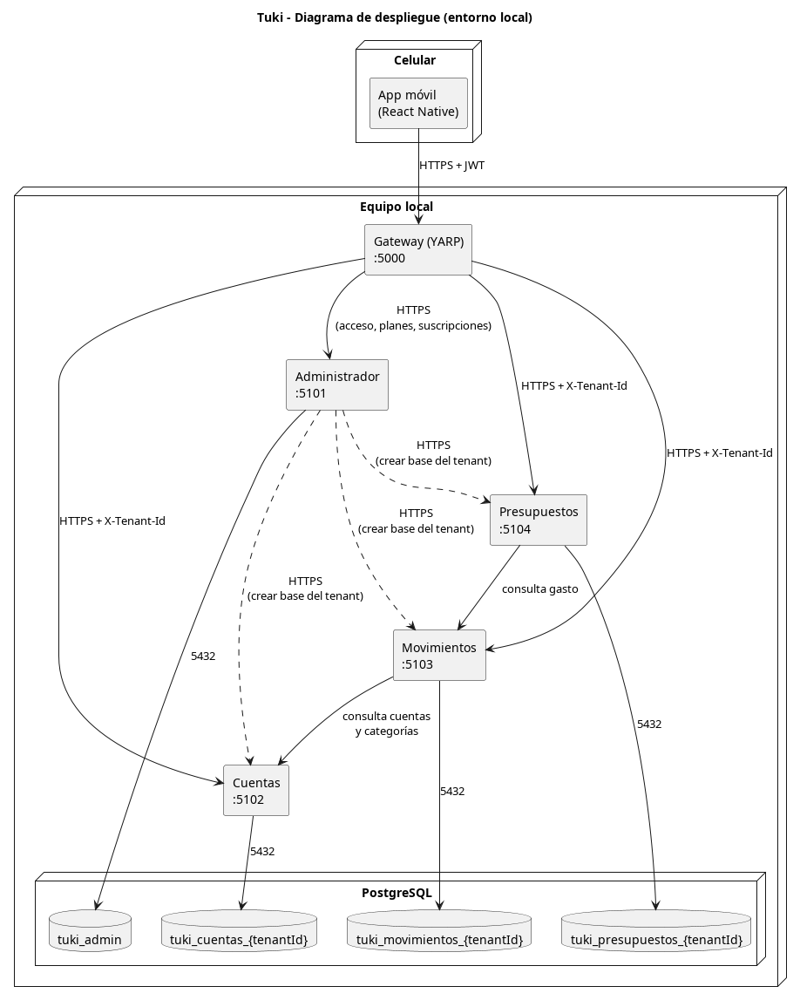

Fuente: [diagrams/despliegue.puml](diagrams/despliegue.puml)

El backend se ejecuta **localmente**: no usa Docker, Kubernetes ni servicios de nube. Cada servicio es un proceso .NET que se levanta con dotnet run en la máquina de desarrollo, y todas las bases viven en un único servidor PostgreSQL local. Las líneas punteadas del diagrama son piezas que se diseñan pero no se implementan en la beta (Suscripciones).

### 2.1 Nodos, entornos de ejecución y artefactos

| Nodo                   | Entorno de ejecución | Artefacto                                                                         | Puerto |
| ---------------------- | -------------------- | --------------------------------------------------------------------------------- | ------ |
| Celular o emulador     | Android              | App móvil React Native                                                            |        |
| Gateway                | .NET con YARP        | Gateway.dll                                                                       | 5000   |
| Identidad              | .NET con Kestrel     | Identity.Api.dll                                                                  | 5101   |
| Tenants                | .NET con Kestrel     | Tenants.Api.dll                                                                   | 5102   |
| Contabilidad           | .NET con Kestrel     | Accounting.Api.dll                                                                | 5103   |
| Suscripciones (diseño) | .NET con Kestrel     | Subscriptions.Api.dll                                                             | 5104   |
| Servidor PostgreSQL    | PostgreSQL           | identity_db, tenants_db (catálogo), tenant_A, tenant_B, subscriptions_db (diseño) | 5432   |

El diagrama muestra **dos tenants con bases separadas** (tenant_A y tenant_B), que son las bases locales donde Contabilidad guarda los datos de cada uno.

### 2.2 Conexiones, protocolos y puertos

| Origen → destino        | Protocolo y puerto           | Para qué                                     |
| ----------------------- | ---------------------------- | -------------------------------------------- |
| App móvil → Gateway     | HTTP, 5000                   | Única entrada para el cliente                |
| Gateway → Identidad     | HTTP, 5101                   | Registro e inicio de sesión (sin token)      |
| Gateway → Contabilidad  | HTTP, 5103                   | Todos los datos contables, con X-Tenant-Id   |
| Gateway → Suscripciones | HTTP, 5104                   | Consulta de planes (diseño)                  |
| Identidad → Tenants     | HttpClient, HTTP, 5102       | Crear el espacio del usuario al registrarse  |
| Tenants → Contabilidad  | HttpClient, HTTP, 5103       | Preparar la base del tenant (crear y migrar) |
| Contabilidad → Tenants  | HttpClient, HTTP, 5102       | Ubicar la base de un tenant                  |
| Cada servicio → su base | SQL sobre TCP (Npgsql), 5432 | Leer y escribir solo en su propia base       |

En el entorno local el tráfico va sobre HTTP sin cifrar. El cifrado sería un requisito al desplegar fuera de la máquina local.

### 2.3 Recorrido de X-Tenant-Id

1. Al iniciar sesión, Identidad entrega un token firmado que incluye el identificador del tenant como un dato (claim).
2. La app envía cada petición al Gateway con ese token. **La app no envía ni elige el tenant.**
3. El Gateway valida el token. Descarta cualquier encabezado X-Tenant-Id que haya enviado el cliente, copia el identificador del token a un encabezado X-Tenant-Id propio y reenvía la petición.
4. En Contabilidad, un middleware revisa el encabezado: debe haber un único valor, con formato de Guid y distinto de vacío. Si algo falla, responde 400. Si es válido, guarda el identificador en un TenantContext que dura lo que dura la petición.
5. El resto del código lee el tenant del TenantContext; ningún controlador sabe a qué base se está conectando.

### 2.4 Selección de la base y uso de HttpClient

1. Para saber a qué base conectarse, un resolutor de Contabilidad le pide al servicio de Tenants, con HttpClient, los datos del tenant: el nombre de su base y su estado. Solo responde si el tenant está activo.
2. Contabilidad guarda la respuesta en memoria durante un tiempo, para no consultar a Tenants en cada petición.
3. Con ese nombre construye la cadena de conexión: toma la cadena base de su configuración (servidor, puerto y credenciales) y reemplaza solo el nombre de la base.
4. El DbContext de esa petición se configura con esa cadena, así que todas las consultas van a la base del tenant y a ninguna otra.
5. Si el tenant no existe o no está activo, la petición se rechaza.

**Creación de un tenant.** Al registrarse, Identidad genera el identificador y le pide a Tenants, por HttpClient, que cree el espacio. Tenants lo registra en su catálogo y le pide a Contabilidad, también por HttpClient, que cree la base y aplique las migraciones. Contabilidad la deja lista con la cuenta «Efectivo», los tipos de cuenta y las categorías base. Tenants marca el espacio como activo y registra el evento.

**Cómo se levanta en local:** primero PostgreSQL, después Tenants, Identidad y Contabilidad (cada uno con dotnet run) y por último el Gateway.

## 3. Diagramas de casos de uso

Hay un diagrama por módulo, con los elementos UML de actores, límite del sistema y las relaciones include, extend y generalización. Los casos con fondo gris repiten un caso de otro diagrama solo para mostrar la conexión.

### 3.1 Diagramas

**Acceso y seguridad: cuenta y acceso** (fuente: [01-acceso.puml](diagrams/casos-de-uso/01-acceso.puml))

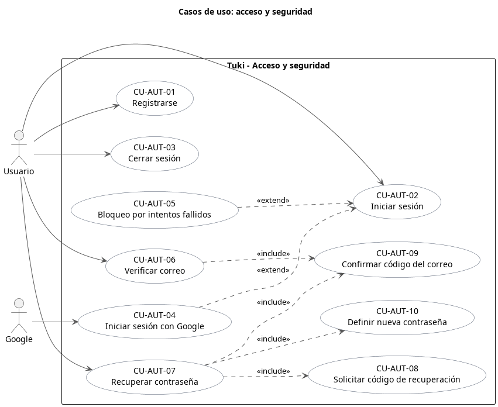

**Acceso y seguridad: PIN de bloqueo** (fuente: [02-pin.puml](diagrams/casos-de-uso/02-pin.puml))

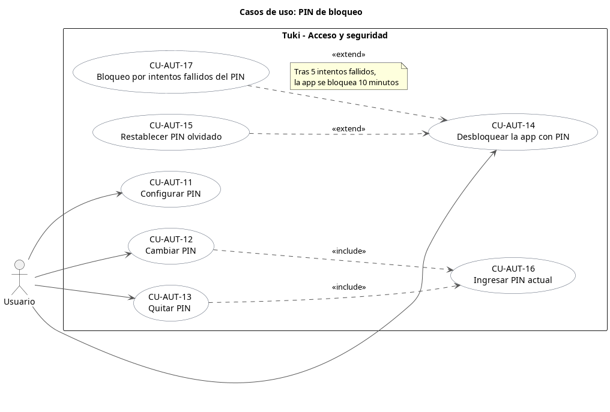

**Cuentas y personalización** (fuente: [03-cuentas-personalizacion.puml](diagrams/casos-de-uso/03-cuentas-personalizacion.puml))

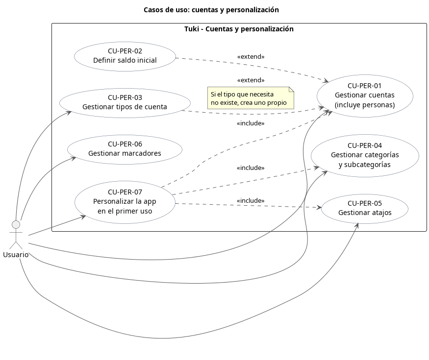

**Movimientos y atajos** (fuente: [04-movimientos.puml](diagrams/casos-de-uso/04-movimientos.puml))

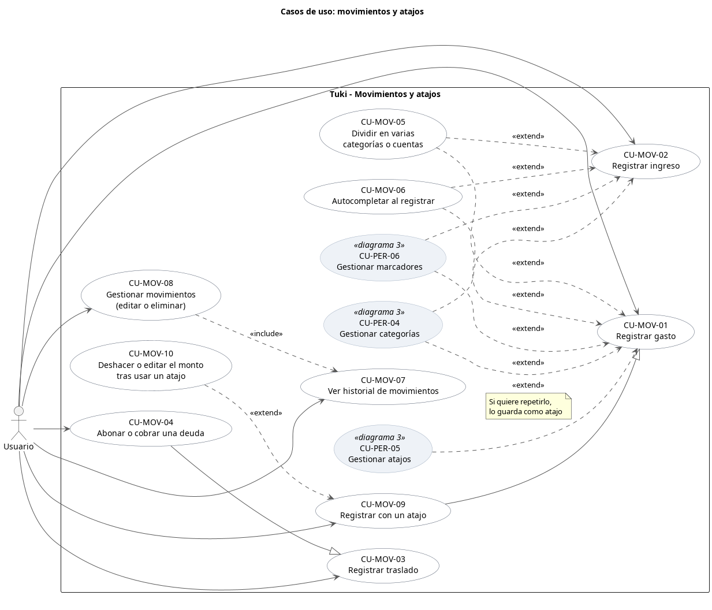

**Seguimiento** (fuente: [05-seguimiento.puml](diagrams/casos-de-uso/05-seguimiento.puml))

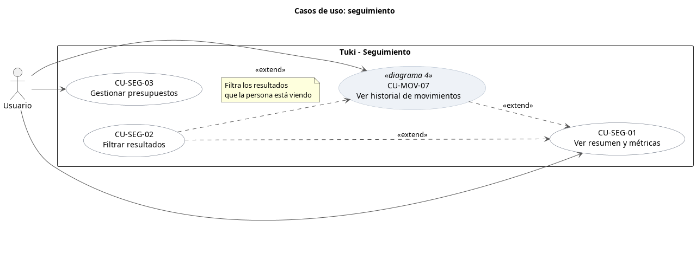

**Suscripciones** (fuente: [06-suscripciones.puml](diagrams/casos-de-uso/06-suscripciones.puml))

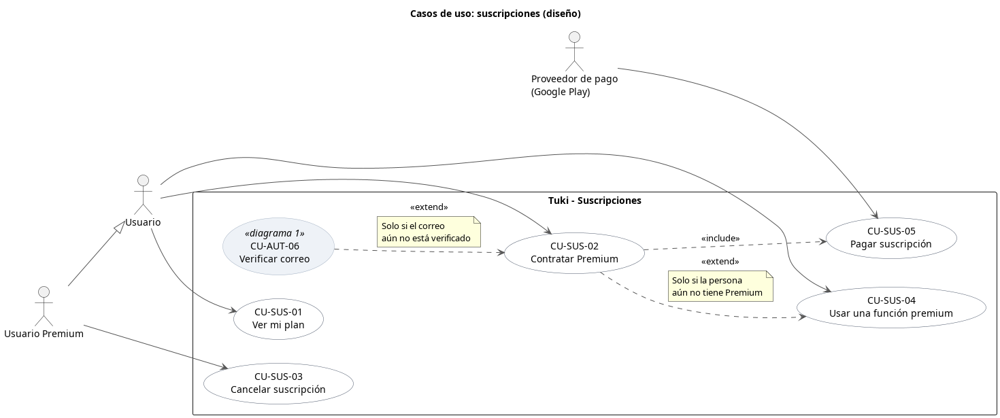

### 3.2 Relaciones UML utilizadas

| Relación       | Dónde se usa                            | Ejemplo                                                                                                                                                             |
| -------------- | --------------------------------------- | ------------------------------------------------------------------------------------------------------------------------------------------------------------------- |
| include        | Pasos que la persona hace siempre       | Recuperar contraseña incluye confirmar el código del correo; cambiar o quitar el PIN incluye ingresar el PIN actual; gestionar movimientos incluye ver el historial |
| extend         | Variantes opcionales o condicionales    | Iniciar sesión con Google extiende iniciar sesión; dividir un movimiento extiende registrar gasto e ingreso                                                         |
| Generalización | Un caso es una forma particular de otro | Registrar con un atajo es un tipo de registrar gasto; abonar una deuda es un tipo de traslado; Usuario Premium es un tipo de Usuario                                |

### 3.3 Coherencia con la base de datos

Cada módulo de casos de uso corresponde a un servicio y a las tablas que son propietarias de su información:

| Módulo                              | Servicio responsable                   | Tablas principales                                                |
| ----------------------------------- | -------------------------------------- | ----------------------------------------------------------------- |
| Acceso y seguridad                  | Identidad (y la app móvil para el PIN) | users, refresh_tokens, verification_tokens, oauth_accounts        |
| Creación del espacio al registrarse | Tenants y Contabilidad                 | tenants, provisioning*events y la base tenant*<id>                |
| Cuentas y personalización           | Contabilidad                           | account_types, accounts, categories, shortcuts, tags              |
| Movimientos y atajos                | Contabilidad                           | transactions, transaction_lines, transaction_tags                 |
| Seguimiento                         | Contabilidad                           | Consultas sobre transaction_lines, accounts, categories y budgets |
| Suscripciones                       | Suscripciones                          | plans, plan_features, subscriptions                               |

Los casos que requieren interacción entre microservicios son CU-AUT-01 (Identidad, Tenants y Contabilidad), CU-SUS-02 (Suscripciones e Identidad) y CU-SUS-04 (Contabilidad y Suscripciones). Además, todos los casos de Contabilidad consultan a Tenants para ubicar la base del usuario.

### 3.4 Actores, límites y tabla de casos de uso

#### Cómo leer este documento

**Actores**

- **Usuario:** la persona que administra sus finanzas. Es el único actor principal.
- **Usuario Premium:** especialización del Usuario. Hace todo lo que hace el Usuario y además puede cancelar su suscripción y usar las funciones premium.
- **Google** y **Proveedor de pago (Google Play):** actores externos, solo en los casos donde participan.

**El espacio del usuario (tenant).** Cada persona que se registra recibe su propio espacio, con una base de datos independiente donde viven sus cuentas, categorías y movimientos. El usuario pertenece a ese espacio y el sistema lo reconoce en cada petición. En los casos de uso este espacio no aparece como actor, sino como el contexto de la persona: nadie ve ni toca datos de otro espacio.

**Columna «Servicios».** Indica qué microservicios participan. Cuando aparece más de uno, el caso requiere interacción entre servicios. Además, todos los casos de Contabilidad pasan por el Gateway y consultan al servicio de Tenants para ubicar la base del usuario, y eso no se repite en cada fila.

**Columna «Nota».** Solo se llena cuando hay algo que aclarar: casos que dependen del tiempo, que son solo de diseño o que tienen valores por definir.

#### Acceso y seguridad

Diagramas: 01-acceso.puml y 02-pin.puml.

| Código    | Caso de uso                           | Objetivo                                                                                       | Actor principal                     | Servicios                                                                        | Nota                                                          |
| --------- | ------------------------------------- | ---------------------------------------------------------------------------------------------- | ----------------------------------- | -------------------------------------------------------------------------------- | ------------------------------------------------------------- |
| CU-AUT-01 | Registrarse                           | Crear su cuenta con correo y contraseña y obtener su espacio personal para empezar a registrar | Usuario                             | Identidad → Tenants → Contabilidad (y Suscripciones para asignar el plan Gratis) | El plan Gratis es parte del diseño                            |
| CU-AUT-02 | Iniciar sesión                        | Entrar a su espacio con su correo y contraseña                                                 | Usuario                             | Identidad                                                                        |                                                               |
| CU-AUT-03 | Cerrar sesión                         | Salir de la app y cerrar su sesión en el dispositivo                                           | Usuario                             | Identidad                                                                        |                                                               |
| CU-AUT-04 | Iniciar sesión con Google             | Entrar sin escribir contraseña, usando su cuenta de Google                                     | Usuario (Google como actor externo) | Identidad                                                                        | Depende del tiempo                                            |
| CU-AUT-05 | Bloqueo por intentos fallidos         | Proteger la cuenta cuando se falla varias veces al iniciar sesión                              | Usuario                             | Identidad                                                                        | Valores por definir                                           |
| CU-AUT-06 | Verificar correo                      | Confirmar que el correo le pertenece                                                           | Usuario                             | Identidad                                                                        | Opcional para usar la app; obligatorio para contratar un plan |
| CU-AUT-07 | Recuperar contraseña                  | Volver a entrar cuando olvidó su contraseña                                                    | Usuario                             | Identidad                                                                        |                                                               |
| CU-AUT-08 | Solicitar código de recuperación      | Pedir que le llegue un código a su correo indicándolo                                          | Usuario                             | Identidad                                                                        | Paso incluido en CU-AUT-07                                    |
| CU-AUT-09 | Confirmar código del correo           | Ingresar el código que recibió para demostrar que tiene acceso al correo                       | Usuario                             | Identidad                                                                        | Paso incluido en CU-AUT-06 y CU-AUT-07                        |
| CU-AUT-10 | Definir nueva contraseña              | Elegir su nueva contraseña tras confirmar el código                                            | Usuario                             | Identidad                                                                        | Paso incluido en CU-AUT-07                                    |
| CU-AUT-11 | Configurar PIN                        | Activar un PIN para proteger la app al abrirla                                                 | Usuario                             | App móvil (local)                                                                | El PIN existe solo en el dispositivo                          |
| CU-AUT-12 | Cambiar PIN                           | Reemplazar el PIN actual por uno nuevo                                                         | Usuario                             | App móvil (local)                                                                |                                                               |
| CU-AUT-13 | Quitar PIN                            | Desactivar el bloqueo con PIN                                                                  | Usuario                             | App móvil (local)                                                                |                                                               |
| CU-AUT-14 | Desbloquear la app con PIN            | Abrir la app ingresando su PIN                                                                 | Usuario                             | App móvil (local)                                                                |                                                               |
| CU-AUT-15 | Restablecer PIN olvidado              | Recuperar el acceso cuando olvidó el PIN, volviendo a iniciar sesión con su contraseña         | Usuario                             | Identidad                                                                        |                                                               |
| CU-AUT-16 | Ingresar PIN actual                   | Demostrar que conoce el PIN antes de cambiarlo o quitarlo                                      | Usuario                             | App móvil (local)                                                                | Paso incluido en CU-AUT-12 y CU-AUT-13                        |
| CU-AUT-17 | Bloqueo por intentos fallidos del PIN | Proteger la app tras 5 intentos fallidos, bloqueándola 10 minutos                              | Usuario                             | App móvil (local)                                                                |                                                               |

#### Cuentas y personalización

Diagrama: 03-cuentas-personalizacion.puml. Las personas (a quienes el usuario presta o debe dinero) son un tipo de cuenta, por eso se gestionan dentro de CU-PER-01.

| Código    | Caso de uso                          | Objetivo                                                                                                          | Actor principal | Servicios    | Nota                           |
| --------- | ------------------------------------ | ----------------------------------------------------------------------------------------------------------------- | --------------- | ------------ | ------------------------------ |
| CU-PER-01 | Gestionar cuentas                    | Crear, editar y archivar sus cuentas (efectivo, banco, cuentas digitales) y las personas con quienes tiene deudas | Usuario         | Contabilidad |                                |
| CU-PER-02 | Definir saldo inicial                | Indicar cuánto dinero tiene (o debe) una cuenta al empezar a usarla                                               | Usuario         | Contabilidad | Variante opcional de CU-PER-01 |
| CU-PER-03 | Gestionar tipos de cuenta            | Crear y archivar tipos de cuenta propios además de los predeterminados                                            | Usuario         | Contabilidad |                                |
| CU-PER-04 | Gestionar categorías y subcategorías | Adaptar las categorías a su forma de gastar: crear, renombrar y archivar                                          | Usuario         | Contabilidad |                                |
| CU-PER-05 | Gestionar atajos                     | Guardar sus gastos rutinarios para registrarlos con un solo toque                                                 | Usuario         | Contabilidad |                                |
| CU-PER-06 | Gestionar marcadores                 | Crear etiquetas libres para agrupar movimientos                                                                   | Usuario         | Contabilidad |                                |
| CU-PER-07 | Personalizar la app en el primer uso | Dejar lista la app con sus cuentas, categorías y atajos desde el comienzo                                         | Usuario         | Contabilidad | Depende del tiempo             |

#### Movimientos y atajos

Diagrama: 04-movimientos.puml.

| Código    | Caso de uso                                   | Objetivo                                                                   | Actor principal | Servicios    | Nota                         |
| --------- | --------------------------------------------- | -------------------------------------------------------------------------- | --------------- | ------------ | ---------------------------- |
| CU-MOV-01 | Registrar gasto                               | Anotar dinero que consumió, saliendo de una cuenta propia o de una persona | Usuario         | Contabilidad |                              |
| CU-MOV-02 | Registrar ingreso                             | Anotar dinero nuevo que entra a una cuenta                                 | Usuario         | Contabilidad |                              |
| CU-MOV-03 | Registrar traslado                            | Mover dinero entre cuentas cuando nadie consumió nada                      | Usuario         | Contabilidad |                              |
| CU-MOV-04 | Abonar o cobrar una deuda                     | Pagar o cobrar una deuda, completa o en partes, con una persona            | Usuario         | Contabilidad | Tipo particular de CU-MOV-03 |
| CU-MOV-05 | Dividir en varias categorías o cuentas        | Repartir un mismo movimiento entre varias categorías o varias cuentas      | Usuario         | Contabilidad | Depende del tiempo           |
| CU-MOV-06 | Autocompletar al registrar                    | Recibir sugerencias de datos ya usados para registrar más rápido           | Usuario         | Contabilidad |                              |
| CU-MOV-07 | Ver historial de movimientos                  | Revisar lo que ha registrado                                               | Usuario         | Contabilidad |                              |
| CU-MOV-08 | Gestionar movimientos                         | Corregir o eliminar un movimiento ya registrado                            | Usuario         | Contabilidad |                              |
| CU-MOV-09 | Registrar con un atajo                        | Registrar un gasto rutinario con un solo toque                             | Usuario         | Contabilidad | Tipo particular de CU-MOV-01 |
| CU-MOV-10 | Deshacer o editar el monto tras usar un atajo | Corregir un atajo recién usado si se equivocó                              | Usuario         | Contabilidad |                              |

#### Seguimiento

Diagrama: 05-seguimiento.puml.

| Código    | Caso de uso            | Objetivo                                                                                                                       | Actor principal | Servicios    | Nota                                    |
| --------- | ---------------------- | ------------------------------------------------------------------------------------------------------------------------------ | --------------- | ------------ | --------------------------------------- |
| CU-SEG-01 | Ver resumen y métricas | Saber cómo van sus finanzas: saldo total y por cuenta, deudas pendientes, gasto del mes por categoría y avance de presupuestos | Usuario         | Contabilidad |                                         |
| CU-SEG-02 | Filtrar resultados     | Acotar lo que ve en el resumen o en el historial                                                                               | Usuario         | Contabilidad | Depende del tiempo; filtros por definir |
| CU-SEG-03 | Gestionar presupuestos | Fijar límites de gasto por categoría o en total, y mantenerlos                                                                 | Usuario         | Contabilidad |                                         |

#### Suscripciones

Diagrama: 06-suscripciones.puml. Este módulo se diseña pero no se implementa en la beta.

| Código    | Caso de uso              | Objetivo                                                                      | Actor principal                                | Servicios                                                       | Nota                                    |
| --------- | ------------------------ | ----------------------------------------------------------------------------- | ---------------------------------------------- | --------------------------------------------------------------- | --------------------------------------- |
| CU-SUS-01 | Ver mi plan              | Saber qué plan tiene y qué incluye                                            | Usuario                                        | Suscripciones                                                   | Solo diseño                             |
| CU-SUS-02 | Contratar Premium        | Pasar al plan Premium para usar sus funciones                                 | Usuario                                        | Suscripciones ↔ Identidad (para comprobar el correo verificado) | Solo diseño                             |
| CU-SUS-03 | Cancelar suscripción     | Dejar de pagar Premium, conservando el acceso hasta el fin del período pagado | Usuario Premium                                | Suscripciones                                                   | Solo diseño                             |
| CU-SUS-04 | Usar una función premium | Aprovechar las funciones exclusivas de Premium                                | Usuario                                        | Contabilidad ↔ Suscripciones (verificar el plan)                | Solo diseño                             |
| CU-SUS-05 | Pagar suscripción        | Realizar el pago de la suscripción con el proveedor                           | Usuario (Proveedor de pago como actor externo) | Suscripciones                                                   | Solo diseño; paso incluido en CU-SUS-02 |

#### Resumen

- **42 casos de uso** en 6 diagramas.
- **5 casos existen solo como pasos incluidos** en otros (CU-AUT-08, CU-AUT-09, CU-AUT-10, CU-AUT-16 y CU-SUS-05). Al escribir las historias de usuario se pueden agrupar con el caso que los usa.
- **Casos con interacción entre servicios:** CU-AUT-01, CU-SUS-02 y CU-SUS-04, además del paso común de ubicar la base del usuario que comparten todos los casos de Contabilidad.

## 4. Historias de usuario

### Cómo leer este documento

- **Épica:** cada módulo de la aplicación es una épica. Si se traslada a Jira, cada épica se crea como Epic y sus historias como Story dentro de ella.
- **Formato:** Como [rol], quiero [funcionalidad] para [beneficio].
- **SP (puntos de historia):** esfuerzo relativo de construir la historia completa, backend y app móvil. Escala: 1 muy simple, 2 simple, 3 media, 5 compleja, 8 muy compleja, 13 la más compleja del proyecto.
- **Módulo responsable:** el microservicio que guarda la información y aplica la regla. El PIN vive solo en la app móvil.
- **Criterios de aceptación:** cada uno se puede comprobar con una prueba manual de la app o una petición a la API. Entre todos describen lo que la historia debe incluir para considerarse terminada.

### Épicas

| Épica                           | Módulo                              | Historias        | SP      |
| ------------------------------- | ----------------------------------- | ---------------- | ------- |
| EP-01 Acceso y seguridad        | Identidad (y app móvil para el PIN) | TK-01 a TK-06    | 44      |
| EP-02 Cuentas y personalización | Contabilidad                        | TK-07 a TK-10    | 21      |
| EP-03 Movimientos y atajos      | Contabilidad                        | TK-11 a TK-15    | 34      |
| EP-04 Seguimiento               | Contabilidad                        | TK-16 a TK-18    | 18      |
| EP-05 Suscripciones             | Suscripciones (solo diseño)         | TK-19 a TK-21    | 18      |
| **Total**                       |                                     | **21 historias** | **135** |

### Valores asumidos

Estos valores no estaban definidos y los propuse para que los criterios sean comprobables. Se pueden cambiar sin rehacer las historias:

- Contraseña de al menos 8 caracteres.
- PIN de 4 dígitos.
- Códigos de correo de 6 dígitos, válidos por 15 minutos.
- Aviso para deshacer un atajo visible por 5 segundos.
- Historial que carga de 30 en 30.
- Bloqueo del inicio de sesión: provisionalmente igual al del PIN (5 intentos y 10 minutos), a la espera de que se defina.

### EP-01 · Acceso y seguridad

Registro, inicio de sesión, recuperación de la cuenta y protección de la app con PIN.

#### TK-01 · Registrarse y crear mi espacio

**Como** usuario nuevo, **quiero** registrarme con mi correo y una contraseña, **para** empezar a llevar mis finanzas en un espacio propio y separado de los demás.

- Casos de uso: CU-AUT-01
- Módulo responsable: Identidad (con Tenants y Contabilidad)
- SP: 13

**Criterios de aceptación**

- [ ] Con un correo válido y una contraseña de al menos 8 caracteres, se crea la cuenta y el usuario entra a la app sin pasos adicionales.
- [ ] Si el correo ya está registrado, se muestra un error y no se crea una segunda cuenta.
- [ ] Si el correo no tiene formato válido o la contraseña es demasiado corta, se indica qué campo corregir.
- [ ] Al terminar el registro, el espacio ya contiene la cuenta «Efectivo» y el conjunto base de categorías, listos para registrar un movimiento, y el usuario queda en el plan Gratis.
- [ ] El espacio es independiente: un segundo usuario registrado después no ve ningún dato del primero.
- [ ] Si falla la creación del espacio, no queda un registro a medias: se muestra un error y el usuario puede reintentar con el mismo correo.

#### TK-02 · Iniciar y cerrar sesión

**Como** usuario, **quiero** entrar a mi cuenta y salir de ella de forma segura, **para** que solo yo pueda acceder a mis datos.

- Casos de uso: CU-AUT-02, CU-AUT-03, CU-AUT-05
- Módulo responsable: Identidad
- SP: 8

**Criterios de aceptación**

- [ ] **Iniciar sesión:** con correo y contraseña correctos, el usuario entra y ve la pantalla principal con sus datos.
- [ ] Con datos incorrectos se muestra «correo o contraseña incorrectos», sin indicar cuál de los dos falló.
- [ ] La sesión se mantiene al cerrar y volver a abrir la app, hasta que el usuario cierre sesión.
- [ ] Si el usuario inicia sesión en otro dispositivo, la sesión del dispositivo anterior deja de funcionar.
- [ ] **Cerrar sesión:** al cerrar sesión, la app vuelve a la pantalla de inicio y no se vuelve a entrar sin credenciales.
- [ ] Una petición a la API con la sesión ya cerrada es rechazada.
- [ ] **Bloqueo por intentos fallidos (provisional):** tras 5 intentos fallidos seguidos no se puede iniciar sesión durante 10 minutos, aunque se use la contraseña correcta.
- [ ] La pantalla indica cuánto falta para poder intentarlo otra vez, y un inicio de sesión correcto antes del quinto fallo reinicia el contador.

#### TK-03 · Iniciar sesión con Google

**Como** usuario, **quiero** entrar con mi cuenta de Google, **para** no tener que recordar otra contraseña.

- Casos de uso: CU-AUT-04
- Módulo responsable: Identidad
- SP: 5

**Criterios de aceptación**

- [ ] Si el correo de Google no tiene cuenta en Tuki, se crea la cuenta con su espacio y el usuario entra.
- [ ] Si ya existe una cuenta con ese correo, el usuario entra a ella y no se crea un duplicado.
- [ ] Si el usuario cancela el cuadro de Google, vuelve a la pantalla de inicio sin errores.
- [ ] Una misma cuenta de Google no puede quedar vinculada a dos usuarios distintos.

#### TK-04 · Verificar mi correo

**Como** usuario, **quiero** verificar mi correo, **para** poder contratar un plan.

- Casos de uso: CU-AUT-06, CU-AUT-09
- Módulo responsable: Identidad
- SP: 5

**Criterios de aceptación**

- [ ] El usuario puede usar toda la app sin haber verificado su correo.
- [ ] Desde su perfil puede pedir un código, que llega por correo con 6 dígitos.
- [ ] Con el código correcto, el correo queda marcado como verificado y el perfil lo muestra.
- [ ] Un código incorrecto o vencido (más de 15 minutos) no verifica nada, se muestra un mensaje y se puede pedir uno nuevo.
- [ ] Un código ya usado no sirve una segunda vez.

#### TK-05 · Recuperar mi contraseña

**Como** usuario que olvidó su contraseña, **quiero** restablecerla con un código enviado a mi correo, **para** volver a entrar a mi cuenta.

- Casos de uso: CU-AUT-07, CU-AUT-08, CU-AUT-09, CU-AUT-10
- Módulo responsable: Identidad
- SP: 5

**Criterios de aceptación**

- [ ] Desde la pantalla de inicio de sesión, al indicar su correo, el usuario recibe un código de 6 dígitos.
- [ ] Si el correo no está registrado, se muestra el mismo mensaje que si lo estuviera, sin revelar si existe la cuenta.
- [ ] Con el código correcto y vigente (15 minutos), el usuario puede escribir una contraseña nueva de al menos 8 caracteres.
- [ ] Después del cambio, la contraseña anterior ya no funciona y la nueva sí.
- [ ] Con un código incorrecto, vencido o ya usado, la contraseña no cambia y se puede pedir otro código.

#### TK-06 · Proteger la app con un PIN

**Como** usuario, **quiero** proteger mi app con un PIN que pueda activar, cambiar y quitar, **para** que nadie pueda abrirla aunque tenga mi teléfono.

- Casos de uso: CU-AUT-11, CU-AUT-12, CU-AUT-13, CU-AUT-14, CU-AUT-15, CU-AUT-16, CU-AUT-17
- Módulo responsable: App móvil (con Identidad para «Olvidé mi PIN»)
- SP: 8

**Criterios de aceptación**

- [ ] **Configurar:** el usuario crea un PIN de 4 dígitos escribiéndolo dos veces; si no coinciden, no se guarda y se avisa.
- [ ] **Privacidad:** el PIN no viaja al servidor; no aparece en ninguna petición de red.
- [ ] **Desbloquear:** con el PIN activo, al abrir la app aparece primero la pantalla de PIN, sin mostrar ningún dato. Con el PIN correcto se entra; con uno incorrecto se muestra un error.
- [ ] **Cambiar:** se pide el PIN actual; si es incorrecto no se puede continuar. Con el correcto se define el nuevo escribiéndolo dos veces, y desde ese momento el anterior ya no abre la app.
- [ ] **Quitar:** se pide el PIN actual; una vez quitado, la app abre sin pedir PIN.
- [ ] **Bloqueo:** tras 5 intentos fallidos seguidos, la app no acepta ningún PIN durante 10 minutos, aunque sea el correcto. Se muestra cuánto falta, un PIN correcto antes del quinto fallo reinicia el contador, y cerrar y volver a abrir la app no reinicia el bloqueo.
- [ ] **Olvidé mi PIN:** la pantalla de PIN ofrece esa opción. Al elegirla se pide iniciar sesión con correo y contraseña; si es correcto, el PIN se elimina y el usuario entra pudiendo configurar uno nuevo; si falla, el PIN no se elimina.

### EP-02 · Cuentas y personalización

Cuentas, personas, categorías, marcadores y atajos: todo lo que el usuario adapta a su medida.

#### TK-07 · Gestionar mis cuentas y personas

**Como** usuario, **quiero** crear y mantener mis cuentas y las personas con las que tengo deudas, **para** saber cuánto dinero tengo y quién me debe o a quién le debo.

- Casos de uso: CU-PER-01, CU-PER-02, CU-PER-03
- Módulo responsable: Contabilidad
- SP: 8

**Criterios de aceptación**

- [ ] **Cuentas:** el usuario puede crear una cuenta con nombre y tipo, y la cuenta «Efectivo» existe desde el primer uso.
- [ ] Puede editar el nombre y el tipo de una cuenta. Al archivarla, deja de ofrecerse al registrar, pero sus movimientos siguen visibles en el historial.
- [ ] **Tipos de cuenta:** existen los tipos efectivo, tarjeta bancaria, cuenta digital, otro y persona. El usuario puede crear tipos propios y archivar cualquiera: un tipo archivado deja de ofrecerse, pero las cuentas que ya lo usan siguen funcionando.
- [ ] Siempre queda al menos un tipo de persona disponible, para poder seguir registrando deudas.
- [ ] **Personas:** una persona es una cuenta de tipo persona y aparece en la lista con su saldo: positivo significa que le debe al usuario y negativo, que el usuario le debe.
- [ ] **Saldo inicial:** al crear una cuenta se puede indicar un saldo inicial, que si se deja vacío es 0. En una persona puede ser positivo o negativo.
- [ ] El saldo mostrado de la cuenta es igual al saldo inicial. Este no se suma a los ingresos del mes ni a los reportes de gastos, y si el usuario lo corrige después, el saldo se ajusta.

#### TK-08 · Gestionar mis categorías y marcadores

**Como** usuario, **quiero** adaptar las categorías y crear marcadores a mi forma de gastar, **para** ver mis finanzas con el detalle que me interesa.

- Casos de uso: CU-PER-04, CU-PER-06
- Módulo responsable: Contabilidad
- SP: 5

**Criterios de aceptación**

- [ ] **Categorías:** desde el primer uso existe un conjunto base de categorías de gastos y de ingresos.
- [ ] El usuario puede crear categorías y subcategorías, con un máximo de dos niveles: una subcategoría no puede tener subcategorías.
- [ ] Puede renombrar y archivar cualquier categoría, incluso las predeterminadas. Una categoría archivada deja de ofrecerse al registrar, pero los movimientos anteriores la conservan.
- [ ] Una categoría de ingreso no aparece al registrar un gasto, y una de gasto no aparece al registrar un ingreso.
- [ ] **Marcadores:** el usuario puede crear un marcador con un nombre, sin repetir nombres, y renombrarlo o archivarlo.
- [ ] Un marcador archivado deja de ofrecerse al registrar, pero los movimientos que ya lo tenían lo conservan.

#### TK-09 · Gestionar mis atajos

**Como** usuario, **quiero** guardar mis gastos rutinarios como atajos, **para** registrarlos después con un solo toque.

- Casos de uso: CU-PER-05
- Módulo responsable: Contabilidad
- SP: 3

**Criterios de aceptación**

- [ ] El usuario puede crear un atajo con nombre, monto, categoría y cuenta.
- [ ] Los atajos aparecen en la pantalla principal en el orden que el usuario eligió.
- [ ] Se puede editar o archivar un atajo; uno archivado deja de aparecer.
- [ ] Editar o archivar un atajo no modifica los gastos que ya se registraron con él.

#### TK-10 · Personalizar la app en el primer uso

**Como** usuario nuevo, **quiero** que la app me guíe para configurar mis cuentas, categorías y atajos, **para** empezar a registrar con todo a mi medida.

- Casos de uso: CU-PER-07
- Módulo responsable: Contabilidad
- SP: 5

**Criterios de aceptación**

- [ ] Tras registrarse, la app guía al usuario por tres pasos cortos: cuentas, categorías y atajos.
- [ ] En cada paso el usuario puede aceptar lo predeterminado o cambiarlo.
- [ ] Al terminar, el usuario llega a la pantalla principal con lo que configuró.
- [ ] La guía aparece solo la primera vez.

### EP-03 · Movimientos y atajos

Registrar, consultar y corregir el dinero que entra, sale o se mueve.

#### TK-11 · Registrar gastos e ingresos

**Como** usuario, **quiero** registrar lo que gasto y lo que gano de forma rápida, **para** saber en qué se va mi dinero y cuánto tengo.

- Casos de uso: CU-MOV-01, CU-MOV-02, CU-MOV-06
- Módulo responsable: Contabilidad
- SP: 8

**Criterios de aceptación**

- [ ] Con monto, cuenta y categoría, el gasto se guarda y el saldo de la cuenta baja ese monto; en un ingreso, el saldo sube.
- [ ] El monto debe ser mayor que 0; con 0 o vacío, no se guarda y se indica el error.
- [ ] La fecha por defecto es hoy y se puede cambiar. La descripción y los marcadores son opcionales.
- [ ] Bajo cada tipo de movimiento aparece una frase guía corta que ayuda a elegir el correcto, por ejemplo «¿Consumiste algo?» bajo gasto y «¿Entró dinero nuevo?» bajo ingreso.
- [ ] Si el gasto lo pagó una persona, el usuario la elige como cuenta y el saldo de esa persona baja.
- [ ] Sin salir de la pantalla de registro, el usuario puede crear una categoría o un marcador nuevo y guardar el gasto como atajo.
- [ ] **Autocompletar:** al escribir en la descripción aparecen sugerencias de descripciones usadas antes. Al elegir una, se rellenan la categoría y la cuenta que el usuario usó la última vez con ella. Las sugerencias salen solo de sus propios movimientos y se pueden ignorar.
- [ ] El movimiento aparece en el historial y suma al gasto o al ingreso del mes de su categoría.

#### TK-12 · Registrar traslados y deudas

**Como** usuario, **quiero** mover dinero entre mis cuentas y registrar lo que presto, debo o me pagan, **para** mantener mis saldos y mis deudas al día.

- Casos de uso: CU-MOV-03, CU-MOV-04
- Módulo responsable: Contabilidad
- SP: 5

**Criterios de aceptación**

- [ ] El usuario elige cuenta de origen, cuenta de destino y monto: el origen baja y el destino sube ese mismo monto. No se pide categoría y no se puede elegir la misma cuenta como origen y destino.
- [ ] Bajo el tipo traslado aparece una frase guía corta, por ejemplo «¿Solo cambió de lugar tu dinero?».
- [ ] Un traslado entre dos cuentas propias no cambia el saldo total, no suma a los gastos ni a los ingresos del mes, y se distingue de ellos en el historial.
- [ ] **Prestar:** un traslado hacia una persona sube su saldo, que significa que ahora le debe al usuario.
- [ ] **Abonar o cobrar:** desde una persona, el usuario elige «me pagó» o «le pagué» e indica un monto. Si un amigo debe 40 Bs y paga 15 Bs, su saldo pasa a 25 Bs y la cuenta del usuario sube 15 Bs.
- [ ] Si el pago iguala la deuda, el saldo de la persona queda en 0. Cada pago aparece en el historial como traslado.

#### TK-13 · Dividir un movimiento en varias categorías o cuentas

**Como** usuario, **quiero** repartir un movimiento entre varias categorías o varias cuentas, **para** registrar con exactitud las compras mixtas.

- Casos de uso: CU-MOV-05
- Módulo responsable: Contabilidad
- SP: 8

**Criterios de aceptación**

- [ ] El usuario puede dividir un gasto o un ingreso en varias líneas, cada una con categoría y monto.
- [ ] La pantalla muestra el total como suma de las líneas y no permite guardar si alguna línea es 0.
- [ ] Con una compra de 60 Bs repartida en 45 Bs de «Comida» y 15 Bs de «Limpieza», cada categoría suma solo su parte en el gasto del mes.
- [ ] Un mismo movimiento puede pagarse desde dos cuentas y cada una baja solo su parte.
- [ ] El historial muestra un solo movimiento con el total.

#### TK-14 · Consultar y corregir mis movimientos

**Como** usuario, **quiero** revisar lo que he registrado y corregirlo si me equivoqué, **para** que mis datos reflejen la realidad.

- Casos de uso: CU-MOV-07, CU-MOV-08
- Módulo responsable: Contabilidad
- SP: 8

**Criterios de aceptación**

- [ ] **Historial:** los movimientos aparecen del más reciente al más antiguo, con fecha, tipo, descripción, monto y categoría. Los traslados se distinguen de los gastos y los ingresos.
- [ ] La lista carga de 30 en 30: los siguientes aparecen al desplazarse hacia abajo.
- [ ] Si todavía no hay movimientos, se muestra un mensaje que invita a registrar el primero.
- [ ] **Editar:** desde el historial, el usuario abre un movimiento y puede cambiar monto, cuenta, categoría, fecha y descripción. Los saldos se recalculan.
- [ ] **Eliminar:** se pide confirmación y, una vez eliminado, los saldos vuelven a como estaban antes del movimiento.
- [ ] Un traslado se edita o se elimina completo, afectando a sus dos cuentas.

#### TK-15 · Registrar con atajos

**Como** usuario, **quiero** registrar un gasto rutinario con un solo toque y poder corregirlo enseguida, **para** no perder tiempo en lo que repito todos los días.

- Casos de uso: CU-MOV-09, CU-MOV-10
- Módulo responsable: Contabilidad
- SP: 5

**Criterios de aceptación**

- [ ] Al tocar un atajo se registra de inmediato un gasto con su monto, categoría y cuenta, con fecha de hoy y sin pedir confirmación.
- [ ] El gasto aparece en el historial y el saldo de la cuenta baja.
- [ ] Si la cuenta del atajo está archivada, no se registra el gasto y se avisa al usuario.
- [ ] Después de tocar el atajo aparece, durante 5 segundos, un aviso con las opciones «Deshacer» y «Editar monto».
- [ ] «Deshacer» elimina el gasto y el saldo vuelve a como estaba. «Editar monto» permite cambiarlo y el saldo se ajusta a la diferencia. Si no se toca ninguna opción, el gasto queda registrado.

### EP-04 · Seguimiento

Saber cómo van las finanzas: resumen, filtros y presupuestos.

#### TK-16 · Ver el resumen y las métricas de mis finanzas

**Como** usuario, **quiero** ver cómo van mis finanzas apenas abro la app, **para** tomar decisiones con información clara.

- Casos de uso: CU-SEG-01
- Módulo responsable: Contabilidad
- SP: 8

**Criterios de aceptación**

- [ ] La pantalla principal muestra el saldo total y el saldo de cada cuenta.
- [ ] Las deudas pendientes aparecen separadas: quién le debe al usuario y a quién le debe el usuario, con sus montos.
- [ ] Se muestra el gasto del mes en curso por categoría, y lo registrado en una subcategoría suma también a su categoría padre.
- [ ] Se muestra el avance de cada presupuesto: lo gastado frente al límite.
- [ ] Las cifras coinciden con la suma de los movimientos del historial.
- [ ] Al tocar una cuenta o una categoría, se ven sus movimientos.
- [ ] Si el usuario aún no tiene movimientos, se muestran los valores en 0 y un mensaje que lo invita a registrar el primero.

#### TK-17 · Filtrar resultados

**Como** usuario, **quiero** filtrar lo que veo, **para** analizar un período, una cuenta o una categoría en particular.

- Casos de uso: CU-SEG-02
- Módulo responsable: Contabilidad
- SP: 5
- Nota: los filtros concretos siguen por definir; estos criterios son provisionales.

**Criterios de aceptación**

- [ ] El usuario puede filtrar el resumen y el historial por período.
- [ ] Puede combinar el período con cuenta, categoría o marcador.
- [ ] Los totales y las listas cambian de acuerdo con los filtros activos.
- [ ] Si no hay resultados, se muestra un mensaje y la opción de quitar los filtros.
- [ ] Al quitar los filtros, se vuelve a ver todo.

#### TK-18 · Gestionar mis presupuestos

**Como** usuario, **quiero** fijar límites de gasto, **para** controlar cuánto gasto por categoría o en total.

- Casos de uso: CU-SEG-03
- Módulo responsable: Contabilidad
- SP: 5

**Criterios de aceptación**

- [ ] El usuario puede crear un presupuesto mensual para una categoría o para el gasto total.
- [ ] No puede haber dos presupuestos mensuales para la misma categoría.
- [ ] El gasto del presupuesto se calcula con los gastos del mes; si es de una categoría padre, incluye sus subcategorías.
- [ ] Cuando el gasto supera el límite, el resumen lo marca como excedido.
- [ ] El usuario puede editar el límite y archivar el presupuesto.

### EP-05 · Suscripciones

Planes Gratis y Premium. Este módulo se diseña pero no se implementa en la beta.

#### TK-19 · Consultar y cancelar mi suscripción

**Como** usuario, **quiero** saber qué plan tengo y poder cancelarlo, **para** tener control de lo que pago.

- Casos de uso: CU-SUS-01, CU-SUS-03
- Módulo responsable: Suscripciones
- SP: 5

**Criterios de aceptación**

- [ ] El usuario ve su plan actual (Gratis o Premium) y las funciones que incluye. Todo usuario nuevo empieza en el plan Gratis.
- [ ] Si es Premium, ve hasta qué fecha está pagado; si está en período de prueba o de gracia, se indica con su fecha de fin.
- [ ] La opción de cancelar solo aparece si el usuario es Premium y pide confirmación.
- [ ] Tras cancelar, el usuario conserva Premium hasta el fin del período ya pagado, y se muestra esa fecha.
- [ ] Al llegar esa fecha, el plan pasa a Gratis y el usuario conserva todos sus datos; solo se limitan las funciones premium.

#### TK-20 · Contratar Premium

**Como** usuario, **quiero** contratar el plan Premium, **para** usar sus funciones exclusivas.

- Casos de uso: CU-SUS-02, CU-SUS-05
- Módulo responsable: Suscripciones (con Identidad)
- SP: 8

**Criterios de aceptación**

- [ ] El usuario ve el precio mensual y el anual y elige uno.
- [ ] Si su correo no está verificado, se le pide verificarlo antes de poder pagar.
- [ ] El pago se realiza con el proveedor de pago; si falla o el usuario cancela, sigue en el plan Gratis.
- [ ] Con el pago exitoso, el plan pasa a Premium de inmediato y el usuario puede usar las funciones premium.
- [ ] Contratar el plan no modifica ni borra ningún dato del usuario.

#### TK-21 · Usar las funciones premium

**Como** usuario Premium, **quiero** usar las funciones exclusivas de mi plan, **para** aprovechar lo que pago.

- Casos de uso: CU-SUS-04
- Módulo responsable: Contabilidad (con Suscripciones)
- SP: 5

**Criterios de aceptación**

- [ ] Un usuario Premium puede usar las funciones premium sin restricciones.
- [ ] Si un usuario Gratis intenta usar una, la función no se ejecuta y se le ofrece contratar Premium.
- [ ] El control lo hace el servidor: una petición directa a una función premium, sin plan Premium, es rechazada aunque la app no muestre el botón.

## 5. Priorización y detalle de las historias del MVP

### Criterio de selección

Una historia entra al MVP si cumple al menos una de estas condiciones:

- Es necesaria para que el producto funcione de punta a punta (sin ella, no se puede registrar ni consultar dinero).
- Resuelve uno de los tres problemas de la app competidora de la Play Store: registrar un gasto es tedioso, no cubre a los deudores y las categorías son pobres.
- Está en los requerimientos que el cliente marcó como indispensables para la beta (RF-01 y RF-03 a RF-11).

El valor para el cliente sale de esos mismos problemas y de las decisiones del propio cliente. La evidencia de validación con usuarios se incorpora en el documento final.

### Historias del MVP, en el orden en que conviene construirlas

El orden respeta las dependencias: cada historia solo depende de las anteriores. Son **11 historias y 79 SP**.

| Orden | Historia                                    | SP  | Necesidad que resuelve                                                                                           | Valor para el cliente                                                               | Depende de                          |
| ----- | ------------------------------------------- | --- | ---------------------------------------------------------------------------------------------------------------- | ----------------------------------------------------------------------------------- | ----------------------------------- |
| 1     | TK-01 Registrarse y crear mi espacio        | 13  | Sin cuenta ni espacio propio no existe nada más. Es además el mayor riesgo técnico, por eso se resuelve primero. | Empezar a usar la app sin configuraciones ni intervención de nadie                  | Nada                                |
| 2     | TK-02 Iniciar y cerrar sesión               | 8   | Permite volver a entrar y asegura que cada petición llegue al espacio correcto                                   | Que solo él acceda a sus datos                                                      | TK-01                               |
| 3     | TK-07 Gestionar mis cuentas y personas      | 8   | Sin cuentas no hay dónde registrar                                                                               | Personas como cuentas con saldo con signo: el diferenciador frente a la competencia | TK-01                               |
| 4     | TK-08 Gestionar mis categorías y marcadores | 5   | Sin categorías no se puede clasificar un gasto                                                                   | Resuelve las «categorías pobres» de la competencia                                  | TK-01                               |
| 5     | TK-11 Registrar gastos e ingresos           | 8   | Es la función central del producto                                                                               | Registrar con pocos pasos, guiado por frases cortas                                 | TK-07, TK-08                        |
| 6     | TK-12 Registrar traslados y deudas          | 5   | Sin traslados no se pueden mover saldos ni cubrir deudores                                                       | Resuelve el problema de los deudores y los pagos parciales                          | TK-07, TK-11                        |
| 7     | TK-14 Consultar y corregir mis movimientos  | 8   | Un error de registro sin corrección deja los saldos mal para siempre                                             | Confianza en que sus datos son correctos                                            | TK-11                               |
| 8     | TK-09 Gestionar mis atajos                  | 3   | Prepara el registro rápido                                                                                       | Atajos propios para sus gastos rutinarios                                           | TK-07, TK-08                        |
| 9     | TK-15 Registrar con atajos                  | 5   | Hace realidad el registro en 1 o 2 clics                                                                         | Registrar un licuado de 5 Bs con un toque, con aviso para deshacer                  | TK-09, TK-11                        |
| 10    | TK-16 Ver el resumen y las métricas         | 8   | Es la pantalla principal; sin ella, lo registrado no se ve                                                       | Saber cuánto tiene, quién le debe y en qué gastó el mes                             | TK-11, TK-12                        |
| 11    | TK-06 Proteger la app con un PIN            | 8   | Es una app de datos financieros y el PIN es un requerimiento del MVP                                             | Tranquilidad de que nadie más abre su app                                           | Solo «Olvidé mi PIN» necesita TK-02 |

TK-06 no depende de las demás, así que se puede construir en cualquier momento. Está al final solo porque no bloquea a nadie.

### Lo que no entra al MVP

| Tipo                                                               | Historias                                                                                               | Motivo                                                                                             |
| ------------------------------------------------------------------ | ------------------------------------------------------------------------------------------------------- | -------------------------------------------------------------------------------------------------- |
| **Dependen del tiempo** (se recortan en este orden si hay retraso) | TK-03 Google, luego TK-10 primer uso guiado, luego TK-17 filtros y por último TK-13 dividir movimientos | El modelo de datos ya soporta las líneas, por eso la interfaz de varias líneas se recorta al final |
| **Posteriores**                                                    | TK-04 Verificar correo, TK-05 Recuperar contraseña, TK-18 Presupuestos                                  | Ninguna es necesaria para registrar y consultar dinero                                             |
| **Solo diseño**                                                    | TK-19, TK-20 y TK-21 (Suscripciones)                                                                    | El plan de suscripciones se diagrama y se contempla en el diseño, pero no se implementa            |

### Alcance del MVP dentro de cada historia

Algunas historias traen más de lo que el MVP necesita. En esos casos, los criterios de aceptación de esa parte quedan para después, sin crear historias nuevas.

| Historia      | Entra en el MVP                                                                             | Queda para después                                                                             |
| ------------- | ------------------------------------------------------------------------------------------- | ---------------------------------------------------------------------------------------------- |
| TK-01         | Registro con correo y contraseña, creación del espacio, cuenta «Efectivo» y categorías base | Asignar el plan Gratis (módulo de suscripciones)                                               |
| TK-02         | Iniciar y cerrar sesión, sesión persistente, una sola sesión por usuario                    | Bloqueo por intentos fallidos (valores por definir)                                            |
| TK-07         | Cuentas, personas, tipos de cuenta predeterminados y saldo inicial                          | Crear tipos de cuenta propios                                                                  |
| TK-08         | Categorías y subcategorías, conjunto base editable                                          | Marcadores                                                                                     |
| TK-11         | Gastos e ingresos, frases guía, pagos hechos por una persona                                | Autocompletar, crear categorías y marcadores desde la pantalla de registro, guardar como atajo |
| TK-12         | Traslados, prestar, abonar y cobrar deudas, frase guía                                      | Nada                                                                                           |
| TK-14         | Historial, edición y eliminación                                                            | Nada                                                                                           |
| TK-09 y TK-15 | Todo                                                                                        | Nada                                                                                           |
| TK-16         | Saldo total y por cuenta, deudas pendientes y gasto del mes por categoría                   | Avance de presupuestos y entrar al detalle de una cuenta o categoría                           |
| TK-06         | Todo, incluido el bloqueo de 5 intentos y 10 minutos                                        | Nada                                                                                           |

### Detalle de las historias del MVP

Todos los flujos pasan por el **Gateway**, que valida la sesión, toma el tenant del token y agrega el encabezado X-Tenant-Id. Los servicios de Contabilidad consultan al servicio de **Tenants** para ubicar la base del usuario. Esos dos pasos no se repiten en cada historia.

#### TK-01 · Registrarse y crear mi espacio

**Condiciones previas**

- La app tiene conexión y el backend (Gateway, Identidad, Tenants, Contabilidad) y PostgreSQL están en ejecución.
- El correo no está registrado.

**Flujo esperado**

1. La persona elige «Registrarse» e indica correo y contraseña.
2. El Gateway reenvía la petición a Identidad, sin pedir sesión.
3. Identidad valida los datos, genera el identificador del espacio y crea al usuario con la contraseña guardada como hash.
4. Identidad le pide a Tenants, con HttpClient, que cree el espacio. Tenants lo registra en su catálogo con estado «en preparación» y define el nombre de la base.
5. Tenants le pide a Contabilidad que cree la base y le aplique las migraciones. Contabilidad la deja con la cuenta «Efectivo», los tipos de cuenta predeterminados y las categorías base.
6. Tenants marca el espacio como activo y deja constancia del evento.
7. Identidad entrega la sesión, cuyo token lleva el identificador del espacio, y la app muestra la pantalla principal.

**Alternativas y errores**

- Correo ya registrado: error de conflicto y no se crea nada.
- Correo con formato inválido o contraseña de menos de 8 caracteres: error de validación que indica el campo.
- Falla la creación de la base: Tenants marca el espacio como fallido y registra el error; Identidad revierte el usuario para que la persona pueda reintentar con el mismo correo.

**Datos necesarios**

- Entrada: correo y contraseña.
- Generados: identificador del usuario, identificador del espacio y nombre de la base.

**Servicios participantes:** Gateway, Identidad, Tenants, Contabilidad.

**Criterios de aceptación:** los de TK-01, salvo la asignación del plan Gratis.

#### TK-02 · Iniciar y cerrar sesión

**Condiciones previas:** la persona tiene una cuenta y su espacio está activo.

**Flujo esperado**

1. La persona ingresa correo y contraseña.
2. El Gateway reenvía a Identidad, que compara con el hash guardado.
3. Si es correcto, Identidad revoca las sesiones anteriores de ese usuario (una sola sesión por persona) y entrega una sesión nueva con el identificador del espacio.
4. La app guarda la sesión de forma segura y muestra la pantalla principal.
5. Al cerrar sesión, la app pide a Identidad que revoque la sesión y borra lo guardado en el dispositivo.

**Alternativas y errores**

- Datos incorrectos: mensaje «correo o contraseña incorrectos», sin indicar cuál falló.
- Cuenta desactivada: acceso rechazado.
- Sesión vencida: la app la renueva sin pedir datos mientras la sesión larga siga vigente; si fue revocada (por ejemplo, por entrar desde otro dispositivo), la app vuelve al inicio de sesión.

**Datos necesarios:** correo, contraseña y la sesión larga guardada en el dispositivo.

**Servicios participantes:** Gateway e Identidad.

**Criterios de aceptación:** los de TK-02, salvo el bloqueo por intentos fallidos.

#### TK-07 · Gestionar mis cuentas y personas

**Condiciones previas:** sesión iniciada y espacio activo.

**Flujo esperado**

1. La persona abre «Cuentas» y elige «Nueva cuenta».
2. Indica nombre, tipo (efectivo, tarjeta bancaria, cuenta digital, otro o persona) y, si quiere, un saldo inicial.
3. Contabilidad crea la cuenta y, si hay saldo inicial distinto de cero, registra el movimiento de apertura.
4. La lista de cuentas se actualiza con el saldo calculado.
5. Para editar o archivar, la persona abre la cuenta y elige la acción.

**Alternativas y errores**

- Nombre vacío: se indica el error.
- Tipo archivado: no se ofrece al crear una cuenta.
- Una persona puede empezar con saldo negativo (le debe a ella) o positivo (le debe a la persona).
- Archivar una cuenta con movimientos la oculta del registro, pero conserva el historial.

**Datos necesarios:** nombre, tipo y saldo inicial opcional. La moneda es fija (bolivianos).

**Servicios participantes:** Gateway, Contabilidad y Tenants (para ubicar la base).

**Criterios de aceptación:** los de TK-07, salvo crear tipos de cuenta propios.

#### TK-08 · Gestionar mis categorías

**Condiciones previas:** sesión iniciada. El conjunto base ya existe desde el registro.

**Flujo esperado**

1. La persona abre «Categorías» y ve las de gastos y las de ingresos.
2. Elige «Nueva categoría», indica nombre y si es de gasto o de ingreso, y opcionalmente una categoría padre para crear una subcategoría.
3. Contabilidad la guarda y aparece en la lista.
4. Para renombrar o archivar, la persona abre la categoría y elige la acción.

**Alternativas y errores**

- Nombre vacío: error de validación.
- Subcategoría de una subcategoría: se rechaza, porque el máximo es de dos niveles.
- Archivar una categoría con movimientos: se permite y los movimientos la conservan.

**Datos necesarios:** nombre, tipo (gasto o ingreso) y categoría padre opcional.

**Servicios participantes:** Gateway, Contabilidad y Tenants.

**Criterios de aceptación:** los de TK-08, salvo los marcadores.

#### TK-11 · Registrar gastos e ingresos

**Condiciones previas:** sesión iniciada, al menos una cuenta y una categoría del tipo correspondiente.

**Flujo esperado**

1. La persona toca «Registrar» y elige gasto o ingreso. Bajo cada opción ve una frase guía corta.
2. Indica monto, cuenta y categoría. La fecha viene en hoy y puede cambiarla; la descripción es opcional.
3. Toca «Guardar». La app envía el movimiento con un identificador generado en el dispositivo.
4. Contabilidad guarda el movimiento: en un gasto el monto resta de la cuenta y en un ingreso suma.
5. La app vuelve a la pantalla principal con los saldos actualizados.

**Alternativas y errores**

- Monto vacío o menor o igual a 0: no se guarda y se indica el error.
- Falta cuenta o categoría: se indica cuál.
- Categoría de otro tipo (de ingreso en un gasto): no se ofrece, y si llega por la API se rechaza.
- Cuenta archivada: no se ofrece, y si llega por la API se rechaza.
- Gasto pagado por una persona: se elige a la persona como cuenta y su saldo baja.
- Sin conexión: se muestra el error y el movimiento no queda registrado a medias.

**Datos necesarios:** tipo, monto, cuenta, categoría, fecha y descripción opcional.

**Servicios participantes:** Gateway, Contabilidad y Tenants.

**Criterios de aceptación:** los de TK-11, salvo autocompletar, crear categorías o marcadores desde esa pantalla y guardar como atajo; incluye las frases guía.

#### TK-12 · Registrar traslados y deudas

**Condiciones previas:** sesión iniciada y al menos dos cuentas (para prestar o cobrar, una de ellas es una persona).

**Flujo esperado**

1. La persona toca «Registrar» y elige «Traslado». Ve la frase guía.
2. Elige cuenta de origen, cuenta de destino y monto.
3. Contabilidad guarda el traslado: el origen baja y el destino sube el mismo monto.
4. Para abonar o cobrar, la persona abre una cuenta de tipo persona, elige «me pagó» o «le pagué» e indica el monto. Es un traslado entre su cuenta y la persona.
5. El saldo de la persona se actualiza: si debía 40 y pagó 15, queda en 25.

**Alternativas y errores**

- Origen igual al destino: se rechaza.
- Monto vacío o menor o igual a 0: no se guarda.
- Un pago que iguala la deuda deja el saldo de la persona en 0.
- Un traslado entre cuentas propias no cambia el saldo total ni cuenta como gasto o ingreso.

**Datos necesarios:** cuenta de origen, cuenta de destino, monto, fecha y descripción opcional.

**Servicios participantes:** Gateway, Contabilidad y Tenants.

**Criterios de aceptación:** los de TK-12, completos.

#### TK-14 · Consultar y corregir mis movimientos

**Condiciones previas:** sesión iniciada. Para editar o eliminar, debe haber movimientos.

**Flujo esperado**

1. La persona abre «Historial» y ve los 30 movimientos más recientes. Al desplazarse hacia abajo se cargan los siguientes.
2. Toca un movimiento para ver el detalle.
3. Para corregirlo, cambia los datos y guarda. Contabilidad actualiza el movimiento y los saldos se recalculan.
4. Para eliminarlo, elige «Eliminar» y confirma. Contabilidad lo borra y los saldos vuelven a como estaban.

**Alternativas y errores**

- Sin movimientos: mensaje que invita a registrar el primero.
- Los mismos errores de validación que al registrar (monto, cuenta, categoría).
- Un traslado se edita o se elimina completo, con sus dos cuentas.
- Movimiento ya eliminado o inexistente: se informa y la lista se actualiza.

**Datos necesarios:** identificador del movimiento y, al editar, los campos que cambian.

**Servicios participantes:** Gateway, Contabilidad y Tenants.

**Criterios de aceptación:** los de TK-14, completos.

#### TK-09 · Gestionar mis atajos

**Condiciones previas:** sesión iniciada, con al menos una cuenta y una categoría de gasto.

**Flujo esperado**

1. La persona abre «Atajos» y elige «Nuevo atajo».
2. Indica nombre, monto, categoría y cuenta.
3. Contabilidad lo guarda y aparece en la pantalla principal.
4. La persona puede reordenar, editar o archivar sus atajos.

**Alternativas y errores**

- Datos vacíos o monto menor o igual a 0: no se guarda.
- Categoría de ingreso: no se ofrece, porque un atajo registra gastos.
- Editar o archivar un atajo no cambia los gastos ya registrados.

**Datos necesarios:** nombre, monto, categoría, cuenta y posición en la lista.

**Servicios participantes:** Gateway, Contabilidad y Tenants.

**Criterios de aceptación:** los de TK-09, completos.

#### TK-15 · Registrar con atajos

**Condiciones previas:** existe al menos un atajo activo.

**Flujo esperado**

1. En la pantalla principal, la persona toca un atajo.
2. La app envía un gasto con los datos del atajo, la fecha de hoy y un identificador generado en el dispositivo.
3. Contabilidad guarda el gasto y el saldo de la cuenta baja.
4. Durante 5 segundos aparece un aviso con «Deshacer» y «Editar monto».
5. «Deshacer» elimina ese gasto. «Editar monto» permite cambiarlo y ajusta el saldo. Si no se toca nada, el gasto queda registrado.

**Alternativas y errores**

- La cuenta del atajo está archivada: no se registra y se avisa.
- Falla la conexión: se muestra el error y no queda un gasto a medias.
- Si se toca el mismo atajo dos veces seguidas, se registran dos gastos; cada uno con su aviso.

**Datos necesarios:** identificador del atajo, fecha de hoy e identificador del movimiento generado en el dispositivo.

**Servicios participantes:** Gateway, Contabilidad y Tenants.

**Criterios de aceptación:** los de TK-15, completos.

#### TK-16 · Ver el resumen y las métricas

**Condiciones previas:** sesión iniciada. Es la pantalla a la que se llega después de iniciar sesión.

**Flujo esperado**

1. Al abrir la app, la pantalla principal pide el resumen a Contabilidad.
2. Contabilidad calcula, a partir de los movimientos del espacio, el saldo total, el saldo por cuenta, las deudas pendientes y el gasto del mes en curso por categoría.
3. La app muestra el resultado, junto con los atajos.

**Alternativas y errores**

- Sin movimientos: valores en 0 y un mensaje que invita a registrar el primero.
- Un gasto en una subcategoría suma también a su categoría padre.
- Falla la conexión: mensaje de error con opción de reintentar.

**Datos necesarios:** el mes en curso. El resto se calcula desde los movimientos.

**Servicios participantes:** Gateway, Contabilidad y Tenants.

**Criterios de aceptación:** los de TK-16, salvo el avance de presupuestos y entrar al detalle de una cuenta o categoría.

#### TK-06 · Proteger la app con un PIN

**Condiciones previas:** la app está instalada. Configurar el PIN no exige haber iniciado sesión, pero lo normal es hacerlo después.

**Flujo esperado**

1. En «Seguridad», la persona elige «Configurar PIN» y lo escribe dos veces.
2. La app guarda el PIN solo en el dispositivo, de forma protegida.
3. Desde ese momento, al abrir la app aparece primero la pantalla de PIN.
4. Con el PIN correcto, se entra a la app. Para cambiarlo o quitarlo, primero se pide el PIN actual.

**Alternativas y errores**

- Los dos PIN no coinciden: no se guarda y se avisa.
- PIN incorrecto: error sin mostrar datos. Tras 5 fallos seguidos, la app se bloquea 10 minutos y cerrar y reabrir no reinicia el bloqueo.
- «Olvidé mi PIN»: la persona inicia sesión con correo y contraseña a través de Identidad; si es correcto, se elimina el PIN y puede configurar uno nuevo.

**Datos necesarios:** PIN de 4 dígitos, contador de intentos y hora de fin del bloqueo, todo guardado en el dispositivo. Nada de esto viaja al servidor.

**Servicios participantes:** App móvil. Solo «Olvidé mi PIN» usa el Gateway y a Identidad.

**Criterios de aceptación:** los de TK-06, completos.

### Riesgos que conviene dejar escritos

- **Crear y migrar una base por usuario (TK-01).** Es el mayor riesgo y por eso se construye primero. Si el tiempo aprieta, es preferible simplificar el resto antes que esta parte.
- **Sin recuperar contraseña (TK-05).** Una persona que olvide su contraseña no puede volver a entrar. Para una beta con pocos usuarios es aceptable, pero debe aclararse en la presentación.
- **Marcadores, autocompletar y presupuestos quedan fuera.** El modelo de datos ya los contempla, así que añadirlos después no obliga a rehacer las tablas.

## 6. Wireframes

Los wireframes cubren las pantallas más determinantes de la aplicación: el acceso, el PIN, la pantalla principal, el registro de movimientos, el historial, las cuentas, la configuración de atajos y categorías, y el menú «Más». Las demás pantallas reutilizan estos mismos componentes (barra de navegación, formularios, listas y selectores), y su comportamiento está descrito en los criterios de aceptación de las historias.

### 6.1 Navegación general

La app usa una **barra de navegación inferior persistente** con cinco espacios: **Inicio**, **Movimientos**, un botón central **+** para registrar, **Cuentas** y **Más**. La opción activa se distingue visualmente. Las pantallas de acceso, PIN y los formularios no muestran la barra.

### 6.2 Pantallas

| Código | Pantalla             | Archivo                  | Historias    | Casos de uso                    |
| ------ | -------------------- | ------------------------ | ------------ | ------------------------------- |
| P-01   | Inicio de sesión     | login.png                | TK-02, TK-03 | CU-AUT-02, CU-AUT-04            |
| P-02   | Registro             | registro.png             | TK-01        | CU-AUT-01                       |
| P-03   | Pantalla de PIN      | pin.png                  | TK-06        | CU-AUT-14, CU-AUT-15            |
| P-04   | Inicio               | inicio.png               | TK-16, TK-17 | CU-SEG-01, CU-SEG-02            |
| P-05   | Crear PIN            | crear-pin.png            | TK-06        | CU-AUT-11, CU-AUT-12            |
| P-06   | Registrar movimiento | registrar-movimiento.png | TK-11, TK-12 | CU-MOV-01, CU-MOV-02, CU-MOV-03 |
| P-07   | Movimientos          | movimientos.png          | TK-14, TK-17 | CU-MOV-07, CU-SEG-02            |
| P-08   | Cuentas              | cuentas.png              | TK-07, TK-12 | CU-PER-01                       |
| P-09   | Nueva cuenta         | nueva-cuenta.png         | TK-07        | CU-PER-01, CU-PER-02            |
| P-10   | Más                  | mas.png                  | TK-19, TK-20 | CU-SUS-01, CU-SUS-02            |
| P-11   | Atajo                | atajo.png                | TK-09, TK-15 | CU-PER-05, CU-MOV-09            |
| P-12   | Configurar categoría | configurar-categoria.png | TK-08        | CU-PER-04                       |

### 6.3 Detalle de cada pantalla

#### P-01 · Inicio de sesión

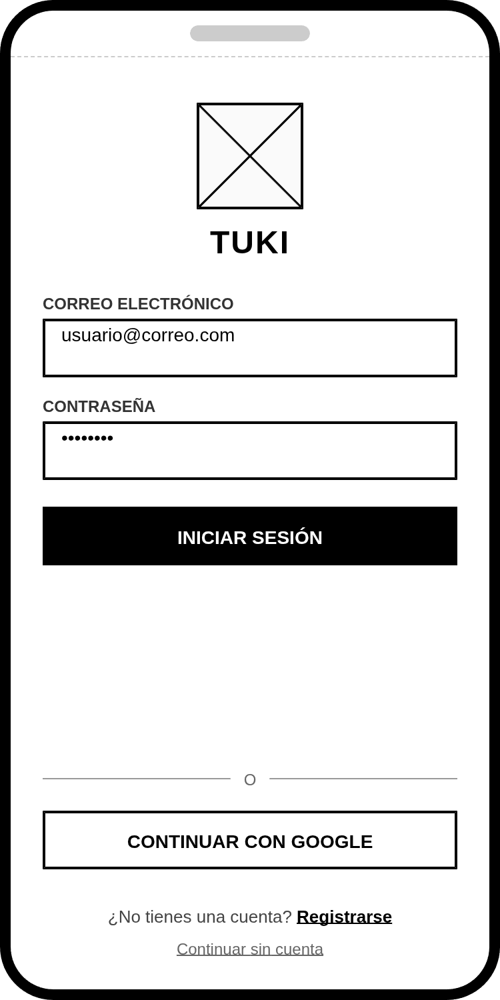

- **Qué muestra:** el logotipo centrado con el nombre Tuki, los campos de correo y contraseña, el botón para iniciar sesión, el botón para entrar con Google y un texto que lleva al formulario de registro.
- **Etapa:** MVP. El acceso con Google depende del tiempo.

#### P-02 · Registro

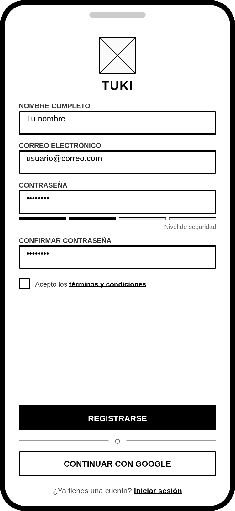

- **Qué muestra:** el logotipo con el título Tuki y el formulario con nombre, correo, contraseña, un indicador segmentado de solidez de la clave, la confirmación de la contraseña y la casilla de aceptación de términos. Abajo, el botón principal de alta, el registro con Google y un texto que lleva de vuelta al inicio de sesión.
- **Etapa:** MVP. El registro con Google depende del tiempo.

#### P-03 · Pantalla de PIN

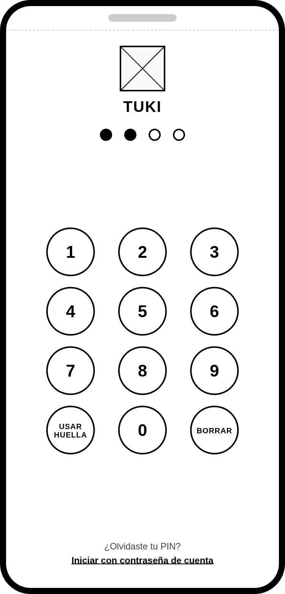

- **Qué muestra:** el logotipo y la fila de círculos que distingue los dígitos ingresados de los pendientes, un teclado numérico de doce botones circulares (con el botón de borrar y el de huella) y, al pie, el enlace de ayuda para recuperar el acceso con la contraseña de la cuenta.
- **Etapa:** MVP. El desbloqueo con huella queda para después del MVP.

#### P-04 · Inicio

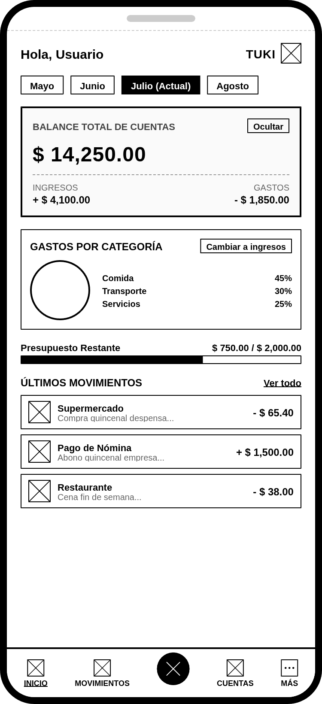

- **Qué muestra:** el saludo de bienvenida y el logotipo, una hilera de filtro mensual con el período actual resaltado, la tarjeta de balance global con botón para ocultar el saldo y el desglose de ingresos y egresos, un gráfico circular monocromático con botón para alternar a ingresos, una barra con el presupuesto disponible y los tres movimientos más recientes (con icono, texto recortado y monto con signo) junto al enlace para ver el historial completo. Cierra la barra de navegación con Inicio activo.
- **Etapa:** MVP. El filtro mensual depende del tiempo y la barra de presupuesto queda para después del MVP.

#### P-05 · Crear PIN

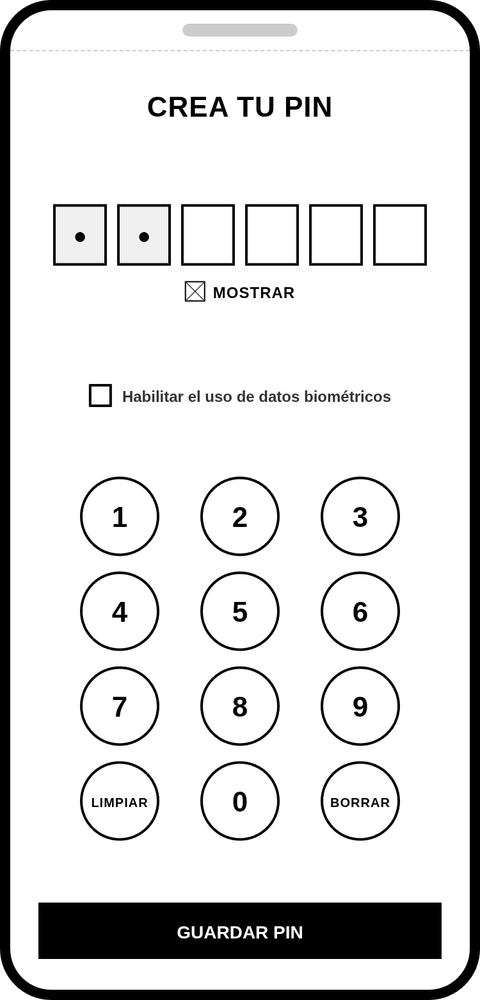

- **Qué muestra:** una pantalla sin barra de navegación con las seis casillas del PIN, el control para mostrar u ocultar la clave, la casilla de consentimiento para el desbloqueo por huella o rostro, un teclado numérico con las funciones de reinicio y de borrado, y el botón de guardado.
- **Etapa:** MVP. El PIN es de 6 dígitos. El desbloqueo por huella o rostro queda para después del MVP.

#### P-06 · Registrar movimiento

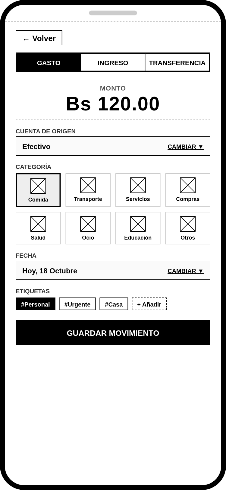

- **Qué muestra:** el botón de retroceso, un selector de tres posiciones (gasto, ingreso o transferencia), el monto en grande en bolivianos, el menú de cuenta con «Efectivo» por defecto, una cuadrícula de categorías (icono y nombre), el selector de fecha con el día en curso, un grupo de etiquetas y el botón de guardado.
- **Etapa:** MVP. Las etiquetas (marcadores) quedan para después del MVP.

#### P-07 · Movimientos

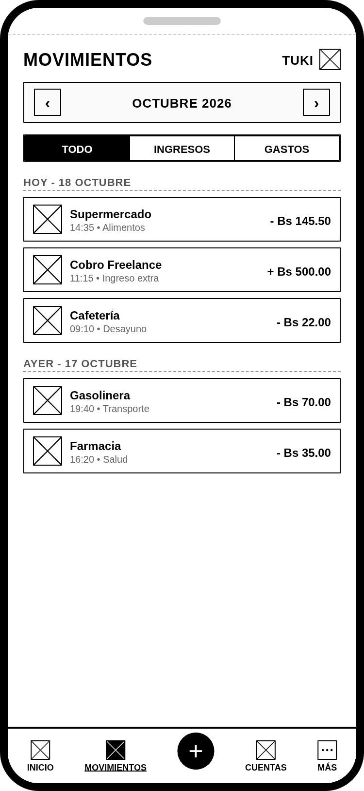

- **Qué muestra:** el título de la vista y la marca, un selector de período con el mes centrado y botones para el mes anterior y el siguiente, un filtro segmentado (todas, ingresos o egresos) y la lista de movimientos agrupada bajo «Hoy» y «Ayer», con icono, hora, categoría y monto en bolivianos. La barra de navegación resalta Movimientos y el botón central muestra el signo más.
- **Etapa:** MVP.

#### P-08 · Cuentas

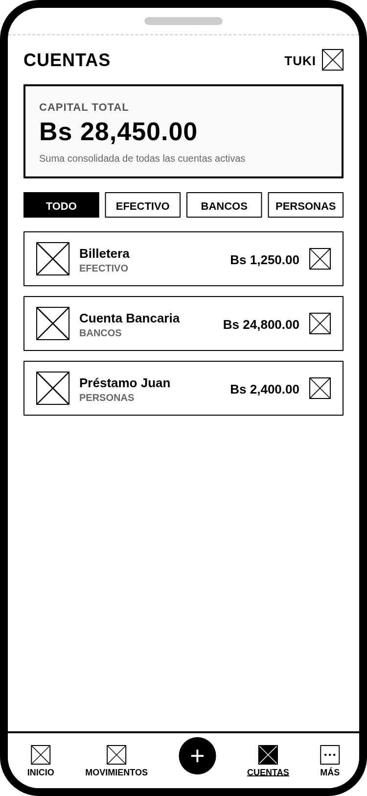

- **Qué muestra:** la tarjeta con el capital total entre todas las cuentas, un filtro por pastillas (todas, efectivo, bancos y personas) y la lista de cuentas, donde cada fila trae un avatar, el nombre, el saldo y un botón de edición a la derecha. Con el filtro de personas se ven los saldos de deudores y acreedores.
- **Etapa:** MVP.

#### P-09 · Nueva cuenta

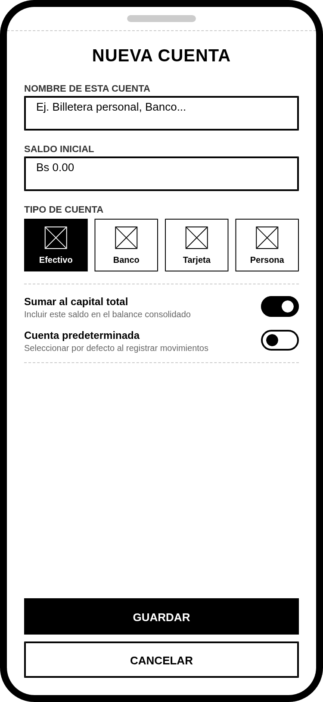

- **Qué muestra:** un formulario sin barra de navegación con el nombre de la cuenta, el saldo inicial, una cuadrícula con los tipos (efectivo, banco, tarjeta y persona), dos interruptores («incluir en el balance global» y «cuenta por defecto») y los botones de guardar y cancelar.
- **Etapa:** MVP.

#### P-10 · Más

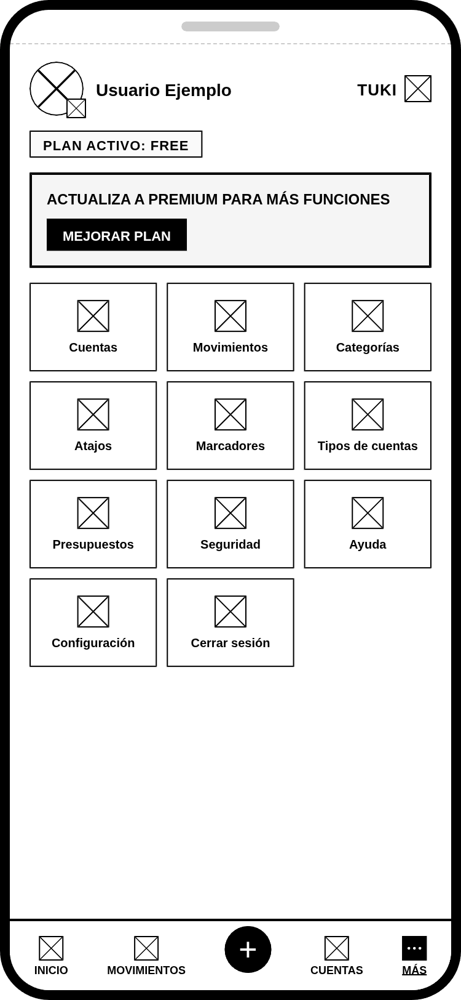

- **Qué muestra:** el avatar con el nombre de la cuenta, la etiqueta del plan actual (Free), una tarjeta para actualizar a Premium con su botón y una cuadrícula de tres columnas con las once utilidades del sistema, desde la que se llega a configuraciones como categorías, atajos y seguridad. La barra de navegación resalta «Más».
- **Etapa:** MVP para las utilidades. La actualización a Premium es solo de diseño.

#### P-11 · Atajo

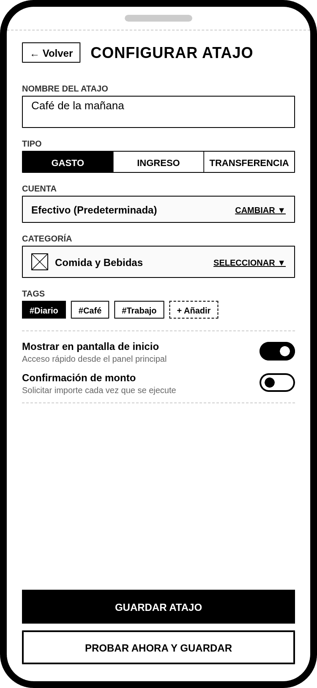

- **Qué muestra:** el título de configuración y el nombre del atajo, un selector del tipo de operación, la cuenta predeterminada (con opción de cambiarla), la categoría, etiquetas rápidas, dos interruptores («visible en la vista principal» y «pedir confirmación del monto antes de guardar») y dos botones: guardar, o probar y guardar.
- **Etapa:** MVP. Los atajos registran gastos; los demás tipos de operación y las etiquetas quedan para después del MVP.

#### P-12 · Configurar categoría

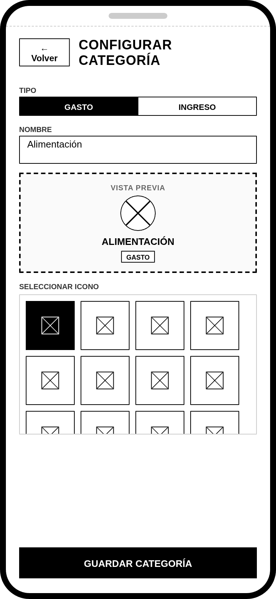

- **Qué muestra:** un conmutador entre ingreso y gasto, el campo del nombre, una tarjeta de vista previa con borde discontinuo (icono, nombre y tipo), una cuadrícula de iconos de cuatro columnas con el seleccionado resaltado y el botón de guardado.
- **Etapa:** MVP.

### 6.4 Conexiones entre pantallas

| Desde                     | Acción                                                   | Hacia                                                     |
| ------------------------- | -------------------------------------------------------- | --------------------------------------------------------- |
| P-01 Inicio de sesión     | Iniciar sesión o entrar con Google                       | P-04 Inicio                                               |
| P-01 Inicio de sesión     | Texto de registro                                        | P-02 Registro                                             |
| P-02 Registro             | Crear cuenta o registrarse con Google                    | P-04 Inicio                                               |
| P-02 Registro             | Texto de inicio de sesión                                | P-01 Inicio de sesión                                     |
| P-03 PIN                  | PIN correcto                                             | La pantalla donde estaba la persona (por lo general P-04) |
| P-03 PIN                  | «Olvidé mi PIN» (recuperar con la contraseña)            | P-01 Inicio de sesión                                     |
| P-04 Inicio               | Botón central «+»                                        | P-06 Registrar movimiento                                 |
| P-04 Inicio               | «Ver historial completo»                                 | P-07 Movimientos                                          |
| P-05 Crear PIN            | Guardar                                                  | P-10 Más                                                  |
| P-06 Registrar movimiento | Guardar o retroceder                                     | P-04 Inicio                                               |
| P-07 Movimientos          | Botón central «+»                                        | P-06 Registrar movimiento                                 |
| P-08 Cuentas              | Botón de edición de una cuenta, o crear una cuenta nueva | P-09 Nueva cuenta                                         |
| P-09 Nueva cuenta         | Guardar o cancelar                                       | P-08 Cuentas                                              |
| P-10 Más                  | Utilidad de seguridad                                    | P-05 Crear PIN                                            |
| P-10 Más                  | Utilidad de atajos                                       | P-11 Atajo                                                |
| P-10 Más                  | Utilidad de categorías                                   | P-12 Configurar categoría                                 |
| P-10 Más                  | Tarjeta de Premium                                       | Planes y suscripción (diseño, sin wireframe)              |
| P-11 Atajo                | Guardar                                                  | P-10 Más                                                  |
| P-12 Configurar categoría | Guardar                                                  | P-10 Más                                                  |
| Barra de navegación       | Inicio, Movimientos, Cuentas, Más                        | P-04, P-07, P-08, P-10                                    |

### 6.5 Qué tenant usa cada recorrido y cómo se reconoce

| Pantallas                 | Contexto de tenant                                                                                                                                    |
| ------------------------- | ----------------------------------------------------------------------------------------------------------------------------------------------------- |
| P-01 Inicio de sesión     | Todavía no hay tenant en la petición. Identidad reconoce al usuario por su correo y entrega un token que lleva el identificador de su tenant.         |
| P-02 Registro             | El tenant aún no existe: se crea durante el registro, y el token que se entrega ya lo incluye.                                                        |
| P-03 PIN y P-05 Crear PIN | Son locales al dispositivo y no consultan al servidor. Protegen la sesión del usuario que ya inició sesión, es decir, su tenant.                      |
| P-04 a P-12               | Usan el tenant del usuario que inició sesión. La app envía el token y el Gateway agrega X-Tenant-Id; Contabilidad se conecta a la base de ese tenant. |

La persona nunca elige un tenant ni lo ve en pantalla: el contexto se reconoce por la sesión. Un ejemplo con dos usuarios: Ana (tenant A) y Luis (tenant B) ven exactamente las mismas pantallas, pero la pantalla de Inicio de Ana muestra sus cuentas y movimientos, que están en la base tenant_A, y la de Luis muestra los suyos, que están en tenant_B. Ninguno ve datos del otro.

### 6.6 Estados comunes

Estos estados no tienen un wireframe propio. Se describen en los criterios de aceptación de las historias.

| Estado               | Dónde aplica                           | Comportamiento                                                                                  |
| -------------------- | -------------------------------------- | ----------------------------------------------------------------------------------------------- |
| Vacío                | P-04 Inicio y P-07 Movimientos         | Valores en 0 y un mensaje que invita a registrar el primer movimiento (TK-14, TK-16)            |
| Error de validación  | P-02, P-06, P-09, P-11 y P-12          | Se indica qué campo corregir y no se guarda (TK-01, TK-07, TK-09, TK-11)                        |
| Error de conexión    | Todas las pantallas con datos          | Mensaje con opción de reintentar, sin dejar un movimiento a medias (TK-11, TK-15, TK-16)        |
| Confirmación         | Eliminar un movimiento y cerrar sesión | Ventana con «Cancelar» y la acción (TK-14, TK-02)                                               |
| Aviso de deshacer    | Tras usar un atajo                     | Aviso de 5 segundos con «Deshacer» y «Editar monto» (TK-15)                                     |
| Bloqueo por intentos | P-03 PIN                               | Tras 5 intentos fallidos, 10 minutos sin aceptar PIN, con el tiempo restante a la vista (TK-06) |

### 6.7 Cobertura de las historias del MVP

| Historia                               | Pantallas  | Observación                                                      |
| -------------------------------------- | ---------- | ---------------------------------------------------------------- |
| TK-01 Registrarse                      | P-02       |                                                                  |
| TK-02 Iniciar y cerrar sesión          | P-01       | El cierre de sesión se describe en los criterios de la historia  |
| TK-06 Proteger con PIN                 | P-03, P-05 | Configurar el PIN usa P-05 y el desbloqueo usa P-03              |
| TK-07 Cuentas y personas               | P-08, P-09 | Las personas se ven con el filtro de P-08                        |
| TK-08 Categorías                       | P-12       | La lista de categorías se llega desde P-10                       |
| TK-09 Atajos                           | P-11       |                                                                  |
| TK-11 Gastos e ingresos                | P-06       |                                                                  |
| TK-12 Traslados y deudas               | P-06, P-08 | Los traslados usan el selector de tipo de P-06                   |
| TK-14 Consultar y corregir movimientos | P-07       |                                                                  |
| TK-15 Registrar con atajos             | P-04, P-11 | Los atajos marcados como visibles aparecen en la vista principal |
| TK-16 Resumen y métricas               | P-04       | Las deudas se consultan en P-08 con el filtro de personas        |
